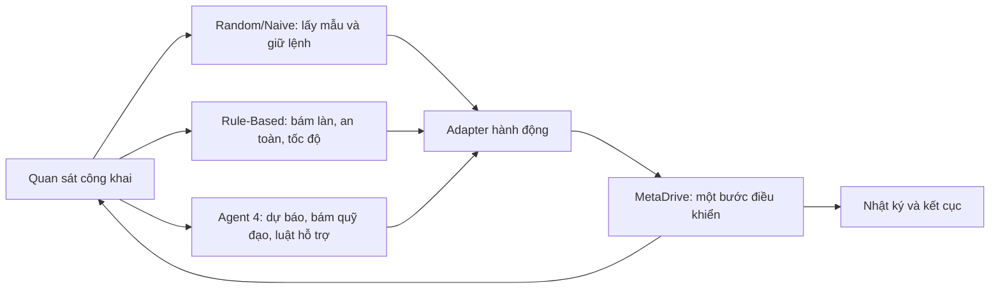

# Báo cáo quá trình phát triển Random/Naive, Rule-Based và Agent 4 PDD

**Tài liệu bàn giao cho phần phương pháp và thực nghiệm của báo cáo nhóm.** Cập nhật ngày 27/11/2026. Bố cục tham khảo báo cáo Search của Phúc trong commit `37b033f` trên `main`. [Báo cáo Search](BAO_CAO_SEARCH_VI.md)

Phần nghiên cứu gồm ba tác tử lái xe trong MetaDrive. **Random/Naive** tạo mốc đối chứng bằng cách lấy mẫu lệnh. **Rule-Based** phối hợp các luật bám làn, tốc độ, nhường đường và chuyển làn. **Agent 4 PDD** dùng dự báo quỹ đạo và tốc độ học từ dữ liệu người lái, rồi chuyển dự báo thành lệnh với sự hỗ trợ của Rule-Based.

Kết quả chính của cặp **Rule-Based v0.6.1** và **Agent 4 PDD v1.0.0** là cả hai đạt **59/96 ca VAL** và **37/60 ca TEST** đến đích an toàn trên cùng danh sách tình huống. Trên các ca cả hai cùng về đích, Agent 4 mất thêm trung bình **12,53 giây mô phỏng ở VAL** và **13,34 giây ở TEST**. Số liệu **0/180 ca TEST** của Random/Naive thuộc **v0.1.1** và dùng ba seed tác tử. [Bảng số liệu và hồ sơ đóng gói](../results/three_agents_handoff_20261127/metrics.json)

## 0. Phạm vi, giao diện và cách đọc thực nghiệm

### 0.1. Câu hỏi nghiên cứu

1. Xe tiến xa đến đâu khi lấy mẫu lệnh đơn giản, và việc đọc điểm phân nhánh giúp thay đổi cách chọn lệnh ở bản Random/Naive mới như thế nào?
2. Các luật về hướng lái, tốc độ, giao lộ và chuyển làn giải quyết được những tình huống nào, và loại lỗi nào còn tồn tại sau các lần cải tiến?
3. Khi giữ cùng tình huống và seed môi trường, Agent 4 bổ sung dự báo học từ người lái thay đổi kết cục, thời gian đến đích và chi phí tính lệnh như thế nào so với Rule-Based?

### 0.2. Quan sát, hành động và vòng điều khiển

Ba tác tử dùng profile `STATE_DECISION_V1`. Tọa độ cục bộ lấy xe làm gốc, trục dọc hướng về phía trước và trục ngang hướng sang trái. Nền tảng đưa dữ liệu quan sát công khai vào `AgentInputV1`. Trạng thái thật trong simulator, kết cục và điểm đánh giá được xử lý ở phía môi trường và bộ ghi kết quả. [Cấu trúc đầu vào](../src/platform/agent_input.py)

| Dữ liệu công khai | Nội dung liên quan | Tác tử sử dụng |
| --- | --- | --- |
| Quan sát lõi | Vector 259 chiều, trong đó 240 giá trị LiDAR | Rule-Based đọc sai lệch xe, tốc độ và vật cản. Agent 4 sử dụng các trạng thái được mã hóa và phần Rule-Based hỗ trợ. |
| Xe xung quanh | Tối đa 8 xe trong mảng trạng thái cơ bản, kèm thông tin hợp lệ và số lượng vượt sức chứa | Rule-Based theo dõi chuyển động và nguy cơ cắt ngang. Agent 4 dùng trạng thái xe lân cận làm đặc trưng dự báo. |
| Tuyến và hình học làn | Điểm tuyến dẫn đường, bề rộng làn, dữ liệu vạch, làn lân cận và vùng giao lộ khi có | Rule-Based dùng để bám làn và xử lý giao lộ, chuyển làn. Agent 4 mã hóa phần tuyến đang quan sát. |
| Điểm phân nhánh | Mã điểm, khoảng cách phía trước và các hướng đi khả dụng | Random/Naive v0.2.0 dùng tín hiệu này để lấy mẫu lại khi đến gần ngã rẽ. |

| Tác tử | Adapter | Đầu ra | Tính ngẫu nhiên khi chạy |
| --- | --- | --- | --- |
| Random/Naive | `discrete9_lowbranch_v1` | Một trong 9 mã lệnh, ghép ba mức lái và ba mức ga/phanh | Có seed tác tử |
| Rule-Based | `continuous_box2_v1` | Cặp giá trị lái và ga/phanh chuẩn hóa trong khoảng `[-1, 1]` | Tất định với cùng đầu vào và cấu hình |
| Agent 4 PDD | `continuous_box2_v1` | Cặp giá trị lái và ga/phanh sau khi bộ điều khiển xử lý dự báo | Tất định khi dùng gói mô hình cố định |

Ở vòng lặp 10 Hz, tác tử đọc quan sát, tính lệnh và đưa lệnh qua adapter. MetaDrive thực hiện năm bước vật lý, mỗi bước 0,02 giây, rồi trả quan sát mới. Bộ ghi nhận quyết định và kết cục theo mã ca. [Ánh xạ hành động](../src/platform/action_adapter.py) · [Cấu hình vòng lặp MetaDrive](../src/launcher/executor.py)



### 0.3. Tập dữ liệu và đơn vị so sánh

Một **hình học** được nhận diện bằng mức khó, chuỗi khối đường, seed hình học và mã băm dựng lại. Một **ca** là một hình học ghép với một seed môi trường, mật độ giao thông và giới hạn bước. Một **lượt chạy** là một lần tác tử thực thi ca đó. Random/Naive chạy lặp theo seed của bản thân tác tử, nên 180 lượt TEST chỉ bao phủ 60 ca và 12 hình học. [MapSuite V1](../datasets/mapsuite_v1/README.md) · [Đính chính cấu hình làn](environment/MAPSUITE_V1_LANE_METADATA_ERRATUM.md)

| Tập MapSuite | Hình học | Quy mô đánh giá | Cách dùng trong tài liệu |
| --- | ---: | --- | --- |
| TRAIN | 180 | Các nhóm ca phát triển được nêu ở từng mục | Thử thiết kế, kiểm tra thuật toán và chuẩn bị dữ liệu học bắt chước |
| VALIDATION (VAL) | 48 | 96 ca, mỗi hình học có seed môi trường 5101 và 5102 | Hai tác tử tất định chạy cùng 96 ca, mỗi mức khó 24 ca |
| TEST | 12 | 60 ca, mỗi hình học có năm seed môi trường từ 9101 đến 9105 | Hai tác tử tất định chạy cùng 60 ca, mỗi mức khó 15 ca. Random/Naive v0.1.1 chạy bộ 60 ca với ba seed tác tử ở một đợt riêng. |

Trong MapSuite, mật độ giao thông lần lượt là 0; 0,08; 0,15 và 0,25 ở bốn mức Easy, Medium, Hard và Extreme. Đây là tham số tạo giao thông của simulator. FIT/DEV trong pilot học bắt chước là hai phần của TRAIN MapSuite. TRAIN/DEV theo người lái trong dự báo PDD là bộ chia của dữ liệu CARLA. Các phép đo trên PDD, TRAIN MapSuite và VAL/TEST MapSuite mang các mẫu số riêng. [Giao thức đánh giá](../configs/platform/evaluation_protocol_v1.json) · [Danh sách ca VAL](../results/audits/evaluation_protocol/validation_case_manifest.csv) · [Danh sách ca TEST](../results/audits/evaluation_protocol/test_case_manifest.csv)

### 0.4. Định nghĩa số liệu và điều kiện đối chiếu

| Chỉ số | Cách tính và cách dùng |
| --- | --- |
| Đến đích an toàn | Số lượt có cờ đến đích và không có lỗi an toàn, chia cho số lượt được báo cáo. |
| Lỗi an toàn | Số lượt có kết cục thuộc nhóm va chạm hoặc ra khỏi đường. Bộ chấm ưu tiên lỗi an toàn khi đồng thời có cờ đến đích. |
| Hết thời gian | Xe đã dùng hết số bước cho phép mà kết cục theo bộ chấm là `TIMEOUT`. Đây là một kết cục lái xe hợp lệ. |
| Hoàn thành tuyến | Tỷ lệ tuyến tại bước cuối, tính trung bình hoặc trung vị trên các lượt của nhóm. Chỉ số đo tiến độ dọc tuyến, còn cột đến đích an toàn dùng kết cục riêng. |
| Thời gian đến đích | Số bước nhân 0,1 giây, chỉ tổng hợp trên lượt đến đích an toàn. Chênh lệch thời gian ghép cặp chỉ dùng những ca cả hai tác tử đều thành công. |
| Tốc độ và độ trễ | Tốc độ trung bình của bảng là trung bình của tốc độ trung bình từng ca. P95 độ trễ tính trên tất cả lần gọi `act()` của tập tương ứng và phản ánh điều kiện chạy song song của lần đo. |

Rule-Based và Agent 4 dùng cùng 156 `case_id`, phiên bản MetaDrive, adapter liên tục và chu kỳ điều khiển. Cấu hình đóng gói được giữ cho cả VAL và TEST. Đợt Random/Naive lịch sử có adapter khác, ba lượt mỗi ca TEST và mốc mã nguồn riêng. Cả ba kết quả giữ lại được dẫn dưới dạng **đánh giá ứng viên**, với `canonical_run=false`. Khi tổng hợp cùng báo cáo Search, mỗi bảng cần giữ cột phiên bản và tên đợt chạy để người đọc nhận ra khác biệt về nguồn. [Định nghĩa chỉ số](../src/platform/metrics.py) · [Bộ phân loại kết cục](../src/platform/episode.py) · [Quy trình thực nghiệm](EXPERIMENT_WORKFLOW.md)

## 1. Random/Naive

### 1.1. Ý tưởng ban đầu

Em cần một tác tử có thể đưa xe di chuyển với rất ít thông tin về đường. Mốc đối chứng này giúp kiểm tra cả hai việc. Một là hành động do tác tử tạo ra có được chuyển đúng thành lệnh MetaDrive hay không. Hai là xe tiến được bao xa khi cách chọn lệnh rất đơn giản. Em cho xe có xu hướng đi thẳng và tăng ga để quan sát được chuyển động dọc đường trong nhiều lượt chạy.

Em chọn chín tổ hợp hành động từ ba mức lái và ba mức ga/phanh. Ở đoạn đường thông thường, xác suất chọn đi thẳng là 60%, trái và phải mỗi hướng 20%. Thành phần dọc được lấy mẫu độc lập, với 10% phanh, 15% thả trôi và 75% tăng ga. Bộ chuyển đổi `discrete9_lowbranch_v1` biến mã tổ hợp thành lệnh lái và ga/phanh. Ba lệnh lái chuẩn hóa là −0,6, 0 và +0,6. Theo dấu lái vật lý trong cấu hình MetaDrive đã kiểm tra, lệnh dương đánh lái sang trái. [Tài liệu Stage 0](STAGE0_RANDOM_NAIVE_AGENT.md) · [Mã tác tử](../src/agents/random_naive_agent.py)

### 1.2. Tạo bản đầu và kiểm tra việc lặp lại

1. **Bản 0.1.0.** Em khởi tạo bộ ngẫu nhiên từ seed của tác tử. Xe giữ lệnh đi thẳng và tăng ga trong 20 bước đầu. Từ lần lấy mẫu tiếp theo, tác tử giữ từng tổ hợp đã chọn trong 20–40 bước. Cách này giúp quan sát tác động của một lệnh qua nhiều bước và làm cho chuỗi hành động dễ đọc khi mở nhật ký.
2. **Bản 0.1.1.** Em thống nhất tên biến đếm giữa phần khởi tạo, đặt lại và ra quyết định. Em cũng sửa mô tả mã hành động 7 thành đi thẳng và tăng ga. Bản này vẫn dùng bộ đếm để đổi lệnh và chưa đọc tình trạng đường.
3. **Đưa vào bộ chạy chung.** Tác tử được đăng ký trong launcher để có thể chọn theo mã `stage0_random_naive`. Việc đặt lại theo từng lượt cho phép thử lại với cùng seed. Nhật ký cho biết bước hiện tại, lệnh đang giữ và số bước còn lại trước khi lấy mẫu.

Quá trình tích hợp ban đầu cũng làm lộ lỗi nhập lớp tác tử từ gói `src.agents`. Hồ sơ tích hợp ghi lại bản sửa ở lớp đăng ký và phần kiểm tra để launcher có thể nạp tác tử với cấu trúc dự án chung. [Kiểm định tích hợp Stage 0](environment/PLATFORM_V1_R0_INTEGRATION_RECOVERY_AUDIT.md)

### 1.3. Cải thiện cách đổi lệnh ở ngã rẽ

Ở bản chỉ dùng bộ đếm, xe có thể vẫn giữ lệnh cũ khi đã tới nơi cần chọn nhánh. Em bổ sung hai thời điểm lấy mẫu cho **bản 0.2.0**. Tác tử lấy mẫu ở bước đầu và khi đồng hồ hết hạn. Nếu một điểm phân nhánh thật xuất hiện cách xe tối đa 8 m, tác tử ưu tiên chọn lại ngay. Sau mỗi lần chọn, thời gian giữ lệnh bắt đầu lại từ 2–4 giây mô phỏng, tương đương 20–40 bước ở 10 Hz. Việc tính theo giây giúp ý nghĩa của khoảng giữ lệnh được giữ khi chu kỳ điều khiển thay đổi.

Để biết xe có thể đi hướng nào, phần trích xuất quan sát xét các đoạn nối trước xe. Em dùng hướng ở cuối đoạn nối để phân biệt trái, thẳng và phải vì nhiều nhánh dùng chung hướng ở lối vào. Khúc cua có một đường đi tiếp, các làn song song và nhánh quay đầu bị loại khỏi tập hướng dùng để lấy mẫu. Ví dụ, khi đến ngã ba chỉ có nhánh trái và phải, tác tử chọn đều giữa hai hướng. Việc chọn ga/phanh giữ phân phối cũ.

Em lưu mã của điểm phân nhánh vừa xử lý để cùng một ngã rẽ không kích hoạt lại ở mọi bước. Sau ba bước liên tiếp ngoài vùng kích hoạt, điểm đó có thể được nhận lại nếu xe quay về. Nhật ký của bản mới ghi lý do chọn lại là bước đầu, hết thời gian hoặc tới điểm phân nhánh. Em kiểm tra bộ đếm theo hai chu kỳ điều khiển, phát lại theo seed, ngã tư, ngã ba không có hướng thẳng và khúc cua không có nhánh. [Cách trích xuất và kiểm thử Stage 0](STAGE0_RANDOM_NAIVE_AGENT.md) · [Các ca kiểm thử](../tests/test_random_naive_agent.py)

**Luồng quyết định của v0.2.0**

```text
Đầu lượt: đặt lại bộ tạo số, thời gian giữ lệnh và ngã rẽ đã nhớ
Mỗi bước:
    Nếu gặp điểm phân nhánh mới trong 8 m: chọn đều một hướng trong danh sách có thật
    Nếu chưa chọn ở bước này và đồng hồ đã hết: lấy mẫu hướng theo xác suất 20/60/20
    Khi đã lấy mẫu hướng: lấy mẫu ga/phanh độc lập và đặt lại đồng hồ 2–4 giây
    Gửi mã hành động đang giữ và giảm bộ đếm một bước
```

Mã rời rạc dùng công thức `3 × chỉ_số_ga_phanh + chỉ_số_lái`. Các mức ga/phanh là `-0.8, 0, 0.6`. Ví dụ, mã 7 tương ứng đi thẳng và tăng ga. Khi ca bắt đầu gần ngã rẽ, tín hiệu điểm phân nhánh được xét trước đồng hồ. [Nguồn tác tử](../src/agents/random_naive_agent.py) · [Nguồn adapter](../src/platform/action_adapter.py)

### 1.4. Thực nghiệm và kết quả

Đợt chạy ứng viên của nhóm ngày 21/11/2026 dùng **v0.1.1** trên 60 tình huống TEST. Mỗi seed tác tử 101, 202 và 303 chạy đủ 60 tình huống, với chu kỳ điều khiển 0,1 giây trên MetaDrive 0.4.3. Tổng cộng có 180 lượt. Hồ sơ gắn nhãn `UNCERTIFIED_CANDIDATE_TEST`, tức một đợt đánh giá ứng viên trên tập TEST. Bảng dưới đây được tính từ CSV của đợt chạy đó.

| Seed tác tử | Số lượt | Đến đích an toàn | Ra khỏi đường | Va chạm xe | Va chạm vỉa hè | Mức hoàn thành tuyến TB |
| --- | ---: | ---: | ---: | ---: | ---: | ---: |
| 101 | 60 | 0 | 50 | 10 | 0 | 15,30% |
| 202 | 60 | 0 | 49 | 11 | 0 | 15,85% |
| 303 | 60 | 0 | 52 | 4 | 4 | 21,22% |
| **Tổng** | **180** | **0** | **151** | **25** | **4** | **17,45%** |

| Mức khó TEST | Lượt | Đến đích an toàn | Ra khỏi đường | Va chạm xe | Va chạm vỉa hè | Tuyến TB |
| --- | ---: | ---: | ---: | ---: | ---: | ---: |
| Easy | 45 | 0 | 45 | 0 | 0 | 27,34% |
| Medium | 45 | 0 | 45 | 0 | 0 | 19,13% |
| Hard | 45 | 0 | 38 | 3 | 4 | 14,81% |
| Extreme | 45 | 0 | 23 | 22 | 0 | 8,54% |

Ra khỏi đường là kết cục chính của 151/180 lượt. Ở Extreme, va chạm xe chiếm 22/45 lượt. Kết quả phù hợp với giới hạn của v0.1.1 về bám làn và phản ứng với xe khác. Manifest ghi commit nền của lần chạy là `206927e` với cây làm việc có thay đổi và lưu mã băm nguồn đi kèm. Commit `68ec4dd` đóng gói kết quả để bàn giao. [Manifest ngày 21/11](../results/result-21-11-2026/candidate_test_session.json) · [CSV 180 lượt Random/Naive](../results/result-21-11-2026/06_Random_Naive/episodes_all_180.csv)

Với **v0.2.0**, em có lượt kiểm tra Workbench trên Easy/SCCS, geometry seed 0, environment seed 0 và agent seed 101. Xe ra khỏi đường ở bước 80, sau khi hoàn thành 9,65% tuyến. Workbench đánh dấu lượt chạy `COMPLETE` và xác minh tệp kết quả. Lần kiểm tra này cũng góp phần xác nhận bản sửa UTF-8 cho tiến trình Workbench trên Windows. Lượt gặp lỗi mã hóa trước đó dừng trước hành động đầu tiên, nên nằm riêng trong hồ sơ lỗi kỹ thuật. [Nhật ký kiểm tra Workbench](../results/audits/WORKBENCH_UTF8_FIX_VI.md)

### 1.5. Phiên bản hiện tại

`stage0_random_naive` v0.2.0 chạy qua launcher và Workbench ở chế độ SANDBOX/AUDIT. Agent dùng đầu vào công khai để nhận biết điểm phân nhánh và vẫn chọn lệnh từ chín tổ hợp. Khi một hướng đã được lấy mẫu, xe chỉ giữ lệnh lái trong khoảng thời gian quy định. Vì chưa có điều khiển bám làn hay bám theo hình dạng của nhánh, xe vẫn có thể bỏ lỡ nhánh đã chọn. Tập 180 lượt ở trên thuộc v0.1.1. Bằng chứng hiện có của v0.2.0 gồm kiểm thử thuật toán và các lượt phát triển đã lưu. [Đăng ký tác tử](../src/launcher/registry.py) · [Tài liệu phiên bản 0.2.0](STAGE0_RANDOM_NAIVE_AGENT.md)

## 2. Rule-Based

### 2.1. Ý tưởng ban đầu

Em xây dựng Rule-Based để xe có thể dựa vào đặc điểm đường và tình trạng giao thông khi quyết định. Em chia việc lái thành các phần nhỏ. Xe cần bám đúng làn trước, sau đó mới chọn tốc độ phù hợp, phát hiện xe phía trước, nhường đường ở giao lộ và chuyển làn khi đủ điều kiện. Cách chia này cho phép xem lỗi xuất phát từ hướng lái, tốc độ, vị trí dừng hay quyết định chuyển làn.

Ở mỗi bước, tác tử lấy tốc độ, sai lệch hướng và độ lệch tâm làn từ quan sát công khai. Các điểm mốc phía trước giúp chuẩn bị vào cua. Tác tử tính riêng giới hạn tốc độ theo độ cong, khoảng đường nhìn thấy, khoảng cách tới giao lộ, xe đi trước và khoảng hở đến biên. Mức thấp nhất trong các giới hạn đang áp dụng trở thành tốc độ mục tiêu. Bộ điều khiển tạo lệnh lái liên tục và điều chỉnh ga/phanh theo sai lệch tốc độ. Nếu khoảng cách quá ngắn hoặc tình huống cần phanh khẩn cấp, lệnh phanh được ưu tiên. [Cách tác tử ra quyết định](RULE_BASED_AGENT_GUIDE.md)

**Công thức điều khiển và tham số mặc định của v0.6.1**

Trên đoạn bám làn thông thường, lệnh lái kết hợp sai hướng, hiệu chỉnh lệch tâm và góc tuyến nhìn trước. Khi chuyển làn, xe có thể lấy đường chuyển làm tham chiếu. Lệnh dọc lấy sai lệch giữa tốc độ mục tiêu và tốc độ hiện tại. Các công thức dưới đây mô tả phần điều khiển cơ sở, trước khi áp dụng lệnh dừng và phanh khẩn cấp. [Mã Rule-Based](../src/agents/rule_based_agent.py)

```text
hiệu_chỉnh_ngang = atan2(1,5 × độ_lệch_ngang, tốc_độ_m/s + 2,0)
lái_cơ_sở       = giới_hạn(1,2 × sai_hướng + hiệu_chỉnh_ngang + 0,5 × góc_nhìn_trước, -0,5, 0,5)
tốc_độ_mục_tiêu = nhỏ_nhất(các_giới_hạn_đang_áp_dụng)
ga_phanh_cơ_sở  = giới_hạn(0,12 × sai_lệch_tốc_độ_km/h, -1, 0,55)
```

| Nhóm | Tham số chính | Tác dụng trong vòng điều khiển |
| --- | --- | --- |
| Bám làn và cua | Nhìn trước cơ sở 5 m, cộng quãng đi trong 0,5 giây và giới hạn ở 12 m. Gia tốc ngang tham chiếu 1,5 m/s². | Chuẩn bị lái và giảm tốc khi độ cong tăng |
| Tốc độ | Trần đường thoáng 45 km/h, gần nút 24 km/h, phục hồi gần biên 8 km/h | Mức giới hạn còn giảm khi xe trước hoặc vật cản làm hẹp khoảng trống |
| Bám và theo dõi xe | Khoảng hở tối thiểu cơ sở 3 m; thời gian bám 1,8 giây; giữ dấu xe mất quan sát tối đa 0,6 giây | Điều chỉnh vận tốc theo xe trước và theo dõi rủi ro qua nhiều bước |
| Xung đột | Dự báo đường thường 4 giây; xét các hướng khả dĩ ở giao lộ tối đa 12 giây; xác nhận khoảng trống trong 0,5 giây | Tạo khoảng chờ trước khi cam kết vào giao lộ |
| Chuyển làn | TTC tham chiếu 4 giây, khoảng hở cơ sở 4 m, giới hạn khi chuyển 24 km/h, giữ 6 giây giữa các lần chuyển | Kiểm tra khoảng trống trước và sau, hạn chế đổi làn liên tục |

TTC là thời gian ước lượng đến lúc xảy ra xung đột nếu chuyển động tiếp tục theo giả thiết dự báo. Ví dụ, khi xe phía sau bắt kịp nhanh ở làn đích, khoảng cách ở thời điểm quan sát có thể vẫn lớn nhưng thời gian tới xung đột ngắn. Tác tử dùng cả hai tín hiệu khi xét chuyển làn. [Tham số mặc định](RULE_BASED_AGENT_GUIDE.md) · [Thiết kế chuyển làn](RULE_BASED_P4_DESIGN.md)

### 2.2. Ổn định hướng lái và tốc độ qua các bản 0.1.0–0.3.0

1. **Bản 0.1.0.** Em thử bám điểm mốc với ga cố định. Trong lượt Easy/SCCS, geometry seed 0 và environment seed 0, xe chạm vạch vàng ở bước 210. Tốc độ tối đa vào khoảng 41,35 km/h. Các chi tiết bản đầu được ghi lại từ tài liệu và CSV còn lưu.
2. **Bản 0.2.0.** Em bổ sung lực kéo xe về tâm làn, sửa hướng xe và nhìn trước góc cua. Xe chạy với trần đường thoáng 22 km/h và giảm hơn khi cần phục hồi về làn. Trên cùng tình huống Easy/SCCS, xe đến đích ở bước 971 với độ lệch tâm lớn nhất khoảng 0,143 m. Các lượt bổ sung trên một seed Easy và một bản đồ Medium cũng đến đích. Bản này là mốc kiểm tra chất lượng bám làn.
3. **Bản 0.3.0.** Sau khi bám làn ổn định hơn, em nâng trần đường thoáng lên 45 km/h và cho tốc độ thay đổi theo đường, khoảng nhìn thấy và xe đi trước. Xe tiếp cận ngã rẽ với trần 24 km/h, còn phục hồi khi gần biên có trần 8 km/h. Trong phép so sánh lịch sử trên bảy tình huống TRAIN, sáu tình huống Easy/Medium đều về đích ở cả hai bản, với thời gian ở 0.3.0 giảm 16,1–39,6%. Cả hai vẫn va chạm ở Hard/SCXOCS.

Kết quả Hard định hướng phần phát triển tiếp theo. Xe cần nhận ra một phương tiện đang đi cắt vào đường mình định đi, kể cả khi phương tiện đó chưa nằm ngay phía trước. [Lịch sử phiên bản](RULE_BASED_CHANGELOG.md) · [CSV so sánh chính sách tốc độ](../results/audits/rule_based/speed_policy_comparison.csv)

### 2.3. Xử lý vật cản, theo dõi xe và qua giao lộ

**Bản 0.4.0.** Em dựng vùng đường mà xe dự kiến đi qua theo hình dạng của tuyến cong. Tác tử xét vị trí và chuyển động của xe khác để phát hiện nguy cơ đi vào vùng đó. LiDAR bổ sung tín hiệu cho vật cản chưa được nhận dạng. Tại Hard/SCTXrCS, nhật ký của một bản thử cho thấy xe đã dừng nhưng vẫn nằm trong vùng xung đột và bị xe khác đang rẽ đâm vào. Em thêm điểm chờ trước lối vào giao lộ, kết hợp điều kiện xác nhận khoảng trống trước khi đi tiếp. Trên chín tình huống TRAIN ghép cặp, số lượt về đích tăng từ 5 lên 7 và va chạm giảm từ 4 xuống 2. Hai ca còn va chạm thuộc Hard. [Báo cáo bản 0.4.0](RULE_BASED_V0_4_0_EXPERIMENT_REPORT.md)

**Bản 0.5.0.** Em bổ sung cách nối quan sát của cùng một xe qua nhiều bước. Tác tử bù chuyển động của xe mình trước khi so vị trí xe khác. Nếu một xe vừa mất khỏi tầm quan sát, dấu vết có thể được giữ đến 0,6 giây. Những hướng đi khả dĩ được ước lượng từ vị trí, vận tốc, hướng và các đoạn đường nối có thể quan sát. Điều này giúp tác tử phân biệt một xe đi song song với một xe có khả năng cắt vào đường mình.

Khi qua giao lộ, tác tử ghi rõ từng bước tiếp cận, nhường, cam kết đi vào, đi qua nút và thoát nút. Em cho xe giữ cùng nhánh đã chọn cho đến khi đuôi xe ra khỏi nút. Khi lối ra bị ùn, xe chờ trước lối vào và đợi khoảng trống ổn định. Trên bộ 16 tình huống TRAIN, số lượt đến đích tăng từ 10 lên 13 so với 0.4.0. Số va chạm giảm từ 4 xuống 0. Ba tình huống Extreme vẫn hết thời gian. [Thiết kế theo dõi xe và giao lộ](RULE_BASED_P2_P3_DESIGN.md) · [Báo cáo bản 0.5.0](RULE_BASED_V0_5_0_EXPERIMENT_REPORT.md)

### 2.4. Thêm chuyển làn và vượt có điều kiện

Ở **bản 0.6.0**, em bổ sung chuyển sang làn kề để theo đúng tuyến hoặc vượt xe chậm. Trình tự xử lý được tách thành các bước sau.

1. Xét yêu cầu chuyển làn bắt buộc theo tuyến trước. Nếu đường phía trước vẫn đi đúng tuyến, tác tử mới xét vượt tùy chọn hoặc trở về làn.
2. Kiểm tra vạch ngăn làn. Luật chỉ cho phép đi qua vạch trắng đứt đã được xác nhận.
3. Kiểm tra khoảng trống trước và sau ở làn đích. Xe phía sau đang tiến nhanh có thể làm mất khoảng trống dù tại thời điểm quan sát còn ở xa. Tác tử xét thêm thời gian đến xung đột, quãng phanh và vùng thân xe dự kiến quét qua.
4. Tạo đường chuyển sang làn kề và giữ mục tiêu đó qua nhiều bước. Nếu phát sinh rủi ro trước khi cam kết, tác tử có thể hủy về làn cũ khi làn cũ còn đủ an toàn. Nếu đã cam kết, tác tử giữ làn đích, phanh khi bị chắn và tiếp tục khi có khoảng trống.

Một bản thử cho phép bắt đầu vượt khi xe đã tiến gần giao lộ, dẫn đến va chạm trên một tình huống Extreme. Em siết điều kiện khởi tạo vượt tùy chọn khi đã thấy nút trong 50 m. Em tách điều kiện bắt đầu chuyển làn khỏi điều kiện tiếp tục một thao tác đang diễn ra, giúp tránh trường hợp xe vừa tới vùng tiếp cận nút đã dừng giữa hai làn.

Em kiểm tra riêng sáu tình huống có dàn dựng. Chúng gồm vượt xe đang chắn, nhường cho xe phía sau áp sát, đổi trái và đổi phải bắt buộc theo tuyến, hủy trước khi cam kết, và phanh rồi đi tiếp khi đang đổi làn. Cả sáu đạt tiêu chí của bài thử, với 929 bước phát lại khớp lệnh gốc. Trong các lượt giao thông bình thường, nhật ký ghi sáu thao tác chuyển làn để vượt được hoàn tất trên năm tình huống. Các bài thử dàn dựng phục vụ kiểm từng luật và được ghi riêng với tỷ lệ đến đích của các lượt chạy toàn tuyến. [Thiết kế chuyển làn](RULE_BASED_P4_DESIGN.md) · [Nhật ký phát triển 0.6.0](RULE_BASED_V0_6_0_WORKLOG.md)

### 2.5. Tổng hợp thực nghiệm và phiên bản hiện tại

Mỗi hàng dưới đây so hai phiên bản trên cùng bộ tình huống và seed môi trường. Ở các lần thử có thay đổi đầu vào công khai, kết quả bao gồm cả tác động của phần trích xuất quan sát và phần điều khiển.

| Phạm vi TRAIN | Hai phiên bản | Đến đích an toàn | Va chạm | Bài học từ lần thử |
| --- | --- | ---: | ---: | --- |
| 9 tình huống Easy/Medium/Hard | 0.3.0 → 0.4.0 | 5/9 → 7/9 | 4 → 2 | Nhường trước vùng xung đột giúp xử lý một số ca giao lộ. |
| 16 tình huống, có Extreme | 0.4.0 → 0.5.0 | 10/16 → 13/16 | 4 → 0 | Theo dõi xe qua nhiều bước và quản lý quá trình qua nút giúp cải thiện trên nhóm đã thử. |
| Cùng 16 tình huống của đợt 0.5.0 | 0.5.0 → 0.6.0 | 13/16 → 13/16 | 0 → 0 | Thêm chuyển làn và giữ được toàn bộ lượt đã thành công. |

Ở bản chốt 0.6.0, cả 16 lượt không ghi nhận ra khỏi đường hoặc chạm vạch liền. Ba lượt Extreme hết thời gian, với mức hoàn thành tuyến khoảng 40,31%, 47,27% và 45,15%. Tác tử vẫn chờ khi lối ra bị chắn hoặc quan sát chưa đủ. Về chi phí tính toán, giá trị p95 cao nhất trong số liệu phát triển là khoảng 72,95 ms, cao hơn mục tiêu nội bộ 10 ms. P95 là mốc thời gian mà khoảng 95% lệnh được tính xong. Điều kiện đo có các tiến trình chạy song song. [Báo cáo bản 0.6.0](RULE_BASED_V0_6_0_EXPERIMENT_REPORT.md)

**Bản hiện tại là v0.6.1**, đăng ký với mã `stage1_rule_based` trong SANDBOX/AUDIT. Em dọn phần mã dư và giữ các luật, tham số của 0.6.0. Hồ sơ bảo trì ghi 547 bài kiểm thử đạt và 1.992 bước phát lại khớp quyết định, lệnh và chẩn đoán với nguồn 0.6.0. Một lượt CLI trên Easy/SCS, geometry seed 0, environment seed 0 và agent seed 42, đến đích sau 418 bước. Kết quả 13/16 thuộc lần kiểm tra lái của 0.6.0. Điều kiện tham gia benchmark chuẩn của tác tử vẫn đang chờ kiểm định. [Hồ sơ bảo trì 0.6.1](SOURCE_CLEANUP_V0_6_1.md) · [Hướng dẫn sử dụng Rule-Based](RULE_BASED_AGENT_GUIDE.md)

### 2.6. Chạy toàn bộ VAL và TEST trên MetaDrive

Đợt chạy bắt đầu lúc 16:20 ngày 26/11/2026 và kết thúc lúc 21:25 ngày 26/11/2026 (giờ Việt Nam). Dùng Rule-Based v0.6.1 với cấu hình mặc định và MetaDrive 0.4.3 tại commit `85e5dadc6c74`. Chạy mỗi tình huống một lần vì tác tử tất định, không đặt seed tác tử. Bản đồ, seed môi trường, mật độ giao thông và giới hạn số bước lấy từ manifest đã khóa. Chu kỳ điều khiển là 0,1 giây. Dùng tối đa sáu tiến trình chạy song song và tắt hiển thị.

Đã hoàn tất **156/156 ca**, gồm **96/96 VAL** và **60/60 TEST**, với **0 lỗi kỹ thuật**. Tổng thời gian theo đồng hồ hệ thống khoảng 5 giờ 5 phút, gồm khoảng gián đoạn của máy. Đợt này được ghi là đánh giá ứng viên trên hai tập giữ lại. Cấu hình tác tử và tiêu chí chứng nhận benchmark được giữ nguyên.

**Kết cục và mức hoàn thành tuyến theo độ khó**

| Tập | Mức | Số ca | Đến đích an toàn | Hết thời gian | Lỗi an toàn | Tuyến TB | Tuyến trung vị |
| --- | --- | ---: | ---: | ---: | ---: | ---: | ---: |
| VAL | Tổng | 96 | 59/96 (61,46%) | 30 | 7 | 76,56% | 98,59% |
| VAL | Easy | 24 | 24/24 (100,00%) | 0 | 0 | 98,62% | 98,67% |
| VAL | Medium | 24 | 21/24 (87,50%) | 3 | 0 | 91,65% | 99,06% |
| VAL | Hard | 24 | 14/24 (58,33%) | 6 | 4 | 77,72% | 99,10% |
| VAL | Extreme | 24 | 0/24 (0,00%) | 21 | 3 | 38,25% | 38,24% |
| TEST | Tổng | 60 | 37/60 (61,67%) | 22 | 1 | 75,74% | 98,78% |
| TEST | Easy | 15 | 15/15 (100,00%) | 0 | 0 | 98,77% | 98,79% |
| TEST | Medium | 15 | 15/15 (100,00%) | 0 | 0 | 99,13% | 99,08% |
| TEST | Hard | 15 | 7/15 (46,67%) | 7 | 1 | 61,87% | 38,79% |
| TEST | Extreme | 15 | 0/15 (0,00%) | 15 | 0 | 43,18% | 39,81% |

Lỗi an toàn gồm va chạm và ra khỏi đường. Kết cục chính của mỗi ca chỉ được tính một lần. Các cờ của simulator có thể cùng xuất hiện trong một ca và được lưu trong CSV.

**Phân loại kết cục chính ở hai tập**

| Kết cục | VAL | TEST |
| --- | ---: | ---: |
| Đến đích an toàn | 59 | 37 |
| Hết thời gian | 30 | 22 |
| Va chạm xe | 6 | 1 |
| Ra khỏi đường | 1 | 0 |

**Thông số vận hành**

| Chỉ số | VAL | TEST |
| --- | ---: | ---: |
| Thời gian đến đích TB trong các ca thành công (giây) | 75,33 | 74,52 |
| Thời gian đến đích trung vị trong các ca thành công (giây) | 70,20 | 66,90 |
| Thời gian mô phỏng TB trên mọi ca (giây) | 136,48 | 143,28 |
| Tốc độ TB theo ca (km/h) | 18,35 | 18,51 |
| Tốc độ cao nhất (km/h) | 45,00 | 45,00 |
| Số bước mô phỏng TB mỗi ca | 1364,8 | 1432,8 |
| Phần thưởng tích lũy TB mỗi ca | 1,1485 | 1,1938 |
| Độ trễ tính lệnh TB theo nhật ký gốc (ms) | 104,79 | 9,69 |
| Độ trễ tính lệnh TB sau khi bỏ một mẫu gián đoạn VAL (ms) | 12,42 | 9,69 |
| Độ trễ tính lệnh trung vị (ms) | 6,01 | 5,51 |
| Độ trễ tính lệnh p95 (ms) | 41,68 | 30,98 |
| Số bước có nhật ký quyết định | 131.017 | 85.966 |

Rule-Based đến đích ở toàn bộ 39 ca Easy. Ở Extreme, cả 15 ca TEST đều hết thời gian. Trong 24 ca VAL ở cùng mức khó, 21 ca hết thời gian và 3 ca va chạm xe. Các ca Extreme có mức hoàn thành tuyến trung bình 38,25% trên VAL và 43,18% trên TEST.

Một lần gọi tính lệnh trong ca `val/Hard/SCXOCS/geom-13/env-5102` ghi 12.102.110,45 ms, trùng với khoảng gián đoạn dài của phiên chạy. Số trung bình có điều chỉnh chỉ loại mẫu này trong 131.017 mẫu VAL. Nhật ký và JSON vẫn giữ số đo gốc. Độ trễ trung vị và p95 được tính từ toàn bộ lần gọi tính lệnh trong mỗi tập, trong điều kiện các tiến trình chia sẻ tài nguyên máy.

Run `rule_based_full_val_test_20261126T092010190738Z` có trạng thái `COMPLETE`. Bảng bàn giao chứa dữ liệu theo từng ca và mã băm của các tệp gốc. Nhật ký quyết định đầy đủ và manifest chi tiết nằm trong thư mục `runs/` của máy chạy. [CSV ghép cặp và số liệu từng ca](../results/three_agents_handoff_20261127/paired_episodes.csv) · [Chỉ số và nguồn gốc Rule-Based](../results/three_agents_handoff_20261127/metrics.json)

## 3. Agent 4 PDD

### 3.1. Ý tưởng ban đầu và chuẩn bị dữ liệu học bắt chước

Ban đầu em muốn cho tác tử học từ những lượt lái đã thực hiện. Một mẫu huấn luyện gồm quan sát trước hành động và đúng lệnh đã gửi vào MetaDrive ở bước đó. Rule-Based được dùng làm tác tử hướng dẫn trong hướng này vì đã lái được trên nhiều tình huống TRAIN và có nhật ký để xem lại khi gặp lỗi. Em kiểm tra đơn vị tốc độ, chiều đánh lái và thứ tự ghép bước trước khi dùng dữ liệu.

Em tách 180 hình học TRAIN thành 144 FIT để học và 36 DEV để kiểm tra. Mọi lượt trên cùng một hình học nằm cùng phía để tránh việc các khung gần giống nhau lọt vào cả hai tập. Từ dữ liệu thử, em tạo hai bộ nhỏ. **BC-A** giữ những đoạn đã qua kiểm tra trong các lượt đến đích và có 566 mẫu FIT, 832 mẫu DEV. **BC-B** giữ toàn bộ mẫu của BC-A, cộng thêm các đoạn được duyệt trong lượt hết thời gian, thành 666 FIT và 1.332 DEV. Nhãn kết cục, chẩn đoán riêng của tác tử hướng dẫn và thông tin xuất xứ được giữ để kiểm tra nguồn. Đầu vào học chỉ nhận phần quan sát đã định nghĩa. Hồ sơ hai bộ dữ liệu được lưu ở commit `c3714be`, tại `autonomous-driving-rl/docs/STAGE4_G1_DATASETS_VI.md`.

Qua những thử nghiệm điều khiển trực tiếp ở workspace phát triển, em thấy hai vấn đề. Dữ liệu xe đang lái ổn định có ít ví dụ về cách quay lại làn sau khi đi lệch. Phần tốc độ cũng có những lần đổi dấu ga/phanh liên tục dù sai số tốc độ trung bình thấp. Em thử bổ sung trạng thái phục hồi và lịch sử quan sát. Sau các lần thử này, em chuyển trọng tâm sang một đầu ra dễ kiểm tra hơn khi đi từ dữ liệu sang MetaDrive. Mô hình dự báo xe nên đi đến đâu và chạy với tốc độ bao nhiêu trong tương lai gần, còn bộ điều khiển sử dụng dự báo đó để tính lệnh.

### 3.2. Chuyển sang dữ liệu PDD và kiểm tra đầu dự báo tốc độ

PDD là **Personalized Driving Dataset**, dữ liệu của người lái trong mô phỏng CARLA. Em dùng PDD để học hành vi chuyển động và dùng MetaDrive để kiểm tra tác tử sau khi tích hợp. Khảo sát dữ liệu gốc bao quát 30 người lái. Em ghép trạng thái xe, thông tin xe xung quanh và hình học đường theo mã lượt và số bước. Vị trí được đổi về hệ gắn với xe, với trục dọc hướng về phía trước và trục ngang hướng sang trái. Các mẫu thiếu mốc tương lai hoặc có thông tin hình học mâu thuẫn được loại hoặc đưa ra kiểm tra riêng. Việc chia theo người lái giúp các khung của cùng một tài xế nằm cùng phía. Tập giữ lại cuối của PDD và tập TEST của MapSuite là hai nguồn riêng.

Em bắt đầu bằng bài toán dự báo tốc độ. Mốc so sánh đơn giản là giả định xe giữ nguyên tốc độ hiện tại. Ở pilot đầu, ExtraTrees giảm sai số tuyệt đối trung bình trên toàn DEV từ 1,811 xuống 1,577 m/s. Tuy nhiên, khi xe đang giảm tốc và có xe khác phía trước, sai số của mô hình là 2,587 m/s, cao hơn mốc giữ tốc độ 2,485 m/s. Em thêm tốc độ ở thời điểm trước đó 0,5 giây và giữ nguyên cách chia dữ liệu. Pilot thứ hai đưa sai số xuống 1,361 m/s trên toàn DEV và 2,196 m/s ở nhóm giảm tốc có xe trước.

Khi dùng pilot thứ hai trên một tình huống Medium có giao thông, cả Rule-Based và bản kết hợp đều đến đích. Rule-Based mất 56,6 giây và bản kết hợp mất 71,9 giây. Nhật ký cho thấy mô hình đã thay đổi nhiều lệnh dọc ngay cả lúc quan sát không có xe khác. Em giữ trọng số rồi thử chỉ cho phần học can thiệp khi có xe trong quan sát. Trên đúng tình huống đó, thời gian của bản kết hợp giảm còn 63,5 giây. Em tiếp tục thử giới hạn vào dải xe phía trước để xem khi nào phần dự báo tốc độ có ích. Loạt thử này giúp xác định rằng phạm vi can thiệp của bộ điều khiển có thể ảnh hưởng đáng kể tới chất lượng chạy vòng kín. Sổ tiến độ cục bộ của Agent 4 ghi loạt thử này ở LOG-019 đến LOG-028.

### 3.3. Dự báo quỹ đạo và cải thiện cách sử dụng dự báo

Em mở rộng từ dự báo tốc độ sang dự báo sáu điểm tương lai tại 0,25, 0,50, 0,75, 1,00, 1,25 và 1,50 giây. Mỗi điểm gồm vị trí trước–sau, vị trí trái–phải và tốc độ. Phần dự báo quỹ đạo dùng 196 đặc trưng về xe, vạch làn, xe xung quanh và tuyến đang quan sát được. Ở nơi có nhiều nhánh và dữ liệu còn mơ hồ, phần đầu tuyến đã xác định được dùng làm tham chiếu. Phần dự báo tốc độ khi xe đang chạy dùng 102 đặc trưng, trong đó có thông tin tốc độ quá khứ. Mô hình ExtraTrees kết hợp dự đoán từ nhiều cây quyết định. [Báo cáo huấn luyện của bản phát hành](../artifacts/agent4_pdd/1.0.0/training_report.json)

Khi áp dụng dự báo vào chạy vòng kín, mỗi lệnh làm thay đổi vị trí và tạo ra quan sát mới. Một bản thử dùng 196 đặc trưng ra khỏi đường ở cả hai ca đầu. Em thay cách chọn điểm tham chiếu bám lái và thêm cơ chế trả quyền lái cho Rule-Based khi xe tiến quá gần biên. Bản tiếp theo đến đích ở 2/2 ca kiểm tra. Đây là mốc kiểm chứng cách dùng dự báo để lái xe trong môi trường.

Em giữ phần dự báo hình học và huấn luyện lại riêng phần tốc độ khi xe đang di chuyển. Dữ liệu được gộp từ các đoạn đường thường và giao lộ, sau khi loại trùng còn 30.199 mẫu TRAIN và 4.680 mẫu DEV. Trên 4.054 mẫu DEV mà xe đang di chuyển, sai số tốc độ tại mốc 1 giây là 1,37 m/s, so với 2,11 m/s của mốc giữ nguyên tốc độ. Nhóm xe đang chạy ổn định vẫn cho kết quả tốt hơn với mốc giữ nguyên tốc độ. Khi xe gần dừng, hệ thống tiếp tục dùng đầu dự báo trước đó. Ở nhóm chờ tại giao lộ, phần này dự báo tốc độ từ 0,3 m/s trở lên tại mốc 1 giây trong 117/119 mẫu. Kết quả cho thấy cải thiện dự báo tốc độ khi đang chạy và xử lý quyết định chờ ở nút cần được kiểm tra riêng. [Báo cáo huấn luyện](../artifacts/agent4_pdd/1.0.0/training_report.json)

| Thành phần của gói phát hành | Đặc tả và số liệu để dẫn |
| --- | --- |
| Nguồn dữ liệu học | Bản ghi người lái của PDD trong CARLA. Dữ liệu trạng thái và hình học được chuyển sang hệ tọa độ gắn với xe và chia theo người lái. |
| Đặc trưng dùng khi chạy | 196 giá trị cho quỹ đạo và 102 giá trị cho đầu tốc độ đang di chuyển. Điều kiện áp dụng đầu tốc độ mới là xe đang di chuyển từ 0,3 m/s và trạng thái vận tốc hợp lệ. |
| Nhãn dự báo | Sáu mốc từ 0,25 đến 1,50 giây. Mỗi mốc có vị trí dọc, vị trí ngang và tốc độ. |
| Đợt huấn luyện đầu tốc độ | Dùng ExtraTrees với 96 cây, ít nhất 8 mẫu ở mỗi lá và seed huấn luyện 42. Hồ sơ gói lưu cả nguồn của phần quỹ đạo được giữ và nguồn của đầu tốc độ được cập nhật. |
| Kiểm tra ngoài mô phỏng | Sai số tuyệt đối trung bình đo trên tập DEV của PDD, đơn vị m/s. Kết quả 1,37 m/s ở mốc 1 giây áp dụng cho 4.054 mẫu đang di chuyển. |
| Tệp dùng khi suy luận | `model_bundle.joblib`, mã băm đầu tiên `3893f571441d`, nạp bằng scikit-learn 1.7.2. Validator kiểm tra gói phát hành trước khi nạp. |

Xem danh sách đặc trưng, thống kê lọc trùng, thiết lập huấn luyện và toàn bộ mã băm trước khi trích dẫn tên mô hình. [Báo cáo huấn luyện](../artifacts/agent4_pdd/1.0.0/training_report.json) · [Manifest gói phát hành](../artifacts/agent4_pdd/1.0.0/manifest.json)

### 3.4. Phối hợp mô hình và Rule-Based trong phiên bản chốt

Bản dùng đầu dự báo tốc độ mới đạt 4/5 ở nhóm Medium/Hard. Ca Hard/XTOCS còn lại hết thời gian khi đã đi 94,17% tuyến. Ở lần chỉnh cuối, em giữ nguyên trọng số. Em thay cách phối hợp phần dự báo và bộ điều khiển để xe duy trì nhịp di chuyển trong những đoạn đủ điều kiện. Đường đi của một bước điều khiển trong bản chốt gồm các phần sau.

1. Agent nhận quan sát công khai và mã hóa trạng thái, tuyến nhìn thấy, xe xung quanh và tốc độ gần đây.
2. ExtraTrees dự báo sáu vị trí và sáu mức tốc độ tương ứng. Bộ bám quỹ đạo chọn điểm tham chiếu phía trước, tính lái và tạo lệnh dọc theo tốc độ đề xuất.
3. Rule-Based đảm nhiệm các thao tác qua nút và đổi làn, các ca chưa xác định được tuyến hoặc khi khoảng hở tới biên làn thấp. Rule-Based cũng đặt giới hạn cho lệnh ga/phanh cuối.
4. Khi đường thoáng và các điều kiện bảo vệ được đáp ứng, bộ điều khiển có thể hỗ trợ hướng tới tốc độ 40 km/h. Mức này được đặt trong cấu hình bộ điều khiển. Trường hợp có rủi ro hoặc mô hình phanh mạnh vẫn chịu các điều kiện bảo vệ.
5. MetaDrive áp dụng lệnh liên tục và trả quan sát cho bước tiếp theo, sau 0,1 giây mô phỏng.

Nhật ký phân biệt dự đoán của mô hình, lệnh trước khi hỗ trợ và lệnh cuối. Em dùng thông tin này để xem phần nào tạo ra thay đổi trong từng lượt. Ví dụ, khi mô hình đề nghị đi tiếp nhưng Rule-Based đang chờ vì lối ra bị chặn, có thể thấy ngay phần nào đang giữ lệnh. [Cách tích hợp bản 1.0.0](AGENT4_PDD_AGENT.md) · [Điểm vào của tác tử](../src/agents/agent4_pdd_agent.py)

| Thành phần | Quyết định được giao |
| --- | --- |
| Mô hình học | Dự báo sáu điểm quỹ đạo và tốc độ tham chiếu từ đầu vào công khai |
| Bộ bám quỹ đạo | Tính lái và ga/phanh đề xuất từ dự báo |
| Rule-Based | Giữ quyền lái ở thao tác hoặc tình huống cần chuyển quyền, như qua nút, đổi làn, tuyến mơ hồ và sát biên. Giới hạn lệnh dọc cuối khi cần giảm tốc hoặc dừng. |
| Bộ hỗ trợ tốc độ | Dùng luật bám nhịp và mức mục tiêu 40 km/h khi điều kiện bảo vệ cho phép. |

Việc đo trên VAL/TEST sử dụng cả bốn thành phần trong bảng. Vì vậy, kết quả phù hợp để mô tả bản PDD kết hợp đã triển khai. Muốn xác định phần cải thiện đến riêng từ trọng số học được thì cần một thí nghiệm kiểm soát thay đổi từng thành phần. [Mã của bộ kết hợp](../src/agents/_pdd_frozen/agent4_integration_audit/audit_compatibility.py)

### 3.5. Thực nghiệm ghép cặp trên Medium và Hard

Em chạy bản hỗ trợ đã chọn trên năm tình huống TRAIN. Mỗi tình huống có một lượt Rule-Based đối chứng trên cùng hình học và seed môi trường. Cả hai tác tử đến đích an toàn ở đủ năm tình huống. Bảng ghi thời gian mô phỏng tính theo giây.

| Mức và bản đồ | Seed hình học / môi trường | Rule-Based | Agent 4 |
| --- | --- | ---: | ---: |
| Medium / SCXCS | 14 / 1 | 54,0 | 62,3 |
| Medium / SCXCCS | 6 / 2 | 84,5 | 99,1 |
| Medium / SCTCS | 11 / 0 | 66,2 | 84,0 |
| Hard / SCXOCS | 15 / 0 | 123,6 | 135,5 |
| Hard / XTOCS | 8 / 2 | 110,6 | 118,5 |

Agent 4 chậm hơn Rule-Based trong cả năm cặp. Tốc độ tối đa ghi nhận ở Agent 4 là 38,82 km/h. Ca Hard/XTOCS đã về đích trong bản hỗ trợ sau khi hết thời gian ở đợt 4/5. Bằng chứng này ghi nhận kết quả của hệ thống gồm mô hình và bộ điều khiển hỗ trợ trên năm tình huống đã khảo sát. [Kết quả từng lượt Medium/Hard](../artifacts/agent4_pdd/1.0.0/evidence/medium_hard_report.json)

### 3.6. Thực nghiệm Extreme và lý do giữ bản hiện tại

Em giữ nguyên mô hình và cấu hình khi chuyển sang Extreme/CrXROSTR, geometry seed 3, với ba seed môi trường. Mỗi tình huống vẫn có một lượt Rule-Based để đối chiếu.

| Seed môi trường | Rule-Based | Agent 4 | Tuyến Agent 4 đã đi | Thời gian Agent 4 |
| --- | --- | --- | ---: | ---: |
| 0 | Va chạm xe | Va chạm xe | 26,33% | 45,8 giây |
| 1 | Hết thời gian | Va chạm xe | 31,22% | 94,7 giây |
| 2 | Va chạm xe | Hết thời gian | 31,12% | 251,4 giây |

Ở seed 2, Agent 4 có một đoạn dừng liên tục 167,9 giây. Khi phát lại quan sát, em thấy trong nhiều bước mô hình đề nghị ga dương nhưng Rule-Based giữ lệnh vì lối ra bị đánh giá là bị chặn. Em thử tắt vượt tùy chọn để xem quyết định vượt trước đó có làm thay đổi kết quả hay không. Biến thể này còn một va chạm và hai lượt hết thời gian, vẫn 0/3 về đích. Em giữ phiên bản đã chạy đạt 5/5 trên Medium/Hard. Đợt thử Extreme chỉ dùng các tình huống TRAIN từng được khảo sát, và cả Agent 4 lẫn đối chứng đều 0/3. Bản thử tắt vượt tùy chọn được ghi trong sổ tiến độ cục bộ, LOG-091 đến LOG-094. [Kết quả ghép cặp Extreme](../artifacts/agent4_pdd/1.0.0/evidence/extreme_report.json)

### 3.7. Bàn giao bản 1.0.0

Em đóng gói bản đã chọn với mã `stage4_pdd_hybrid`, phiên bản **1.0.0**. Mô hình đã học, cấu hình và mã kiểm tra tính toàn vẹn nằm trong dự án chính. Agent sử dụng đầu vào công khai chung, phát lệnh lái và ga/phanh liên tục tại 10 Hz, và xuất hiện trong launcher cùng Random/Naive và Rule-Based. Hồ sơ đóng gói ghi đã kiểm tra 21 mã băm và phát lại 32 bước liên tiếp để đối chiếu lệnh. Lượt kiểm tra qua launcher trên Medium/SCXCS, geometry seed 14, environment seed 1 và agent seed 42, đến đích sau 623 bước, tương đương 62,3 giây mô phỏng.

Agent 4 chạy được ở SANDBOX/AUDIT. Mô hình đang ở trạng thái `DEV_NEEDS_FIX` do các tiêu chí quỹ đạo và dự báo chờ ở giao lộ còn mở. Điều kiện benchmark chuẩn và kiểm tra lái độc lập cũng còn mở. Bản bàn giao giữ vai trò thử nghiệm cách phối hợp mô hình học từ dữ liệu với Rule-Based, với bằng chứng thành công ở nhóm Medium/Hard đã thử và các lỗi còn thấy rõ ở Extreme. [Hồ sơ phát hành Agent 4](AGENT4_PDD_AGENT.md)

### 3.8. Chạy toàn bộ VAL và TEST trên MetaDrive

Đợt chạy bắt đầu lúc 22:11 ngày 26/11/2026 và kết thúc lúc 00:15 ngày 27/11/2026 (giờ Việt Nam). Dùng Agent 4 PDD v1.0.0 với gói mô hình đã xác minh, MetaDrive 0.4.3, chu kỳ 0,1 giây và tối đa sáu tiến trình chạy song song ở chế độ tắt hiển thị.

Đã hoàn tất **156/156 ca**, gồm **96 VAL** và **60 TEST**, với **0 lỗi kỹ thuật**. Mỗi ca dùng đúng bản đồ, seed môi trường, mật độ giao thông và giới hạn bước của đợt Rule-Based ở mục 2.6. Agent 4 chạy một lượt mỗi ca vì tác tử tất định. Đây là đợt đánh giá ứng viên của toàn bộ hệ thống kết hợp, gồm mô hình dự báo và phần Rule-Based hỗ trợ.

Phiên chạy bắt đầu ở commit e86ab9f. Repo được cập nhật lên 37b033f sau khi sáu tiến trình đã nạp Agent 4. Manifest gốc giữ trạng thái FAILED ở bước kiểm tra mã băm toàn repo. Kiểm tra sau chạy xác nhận 21 tệp trong gói phát hành, bao gồm mô hình, phần đầu vào và Rule-Based hỗ trợ, vẫn khớp. Hàm tạo cấu hình headless và phần đăng ký Agent 4 giữ cùng nội dung. Phát lại 1.261 bước từ nhật ký cho cùng lệnh gốc. Số liệu dưới đây được tổng hợp sau đối chiếu để ghi rõ nguồn của đợt chạy.

**Kết cục và mức hoàn thành tuyến theo độ khó**

| Tập | Mức | Số ca | Đến đích an toàn | Hết thời gian | Lỗi an toàn | Tuyến TB | Tuyến trung vị |
| --- | --- | ---: | ---: | ---: | ---: | ---: | ---: |
| VAL | Tổng | 96 | 59/96 (61,46%) | 30 | 7 | 76,75% | 98,55% |
| VAL | Easy | 24 | 24/24 (100,00%) | 0 | 0 | 98,61% | 98,65% |
| VAL | Medium | 24 | 20/24 (83,33%) | 4 | 0 | 89,16% | 99,05% |
| VAL | Hard | 24 | 15/24 (62,50%) | 5 | 4 | 78,61% | 99,20% |
| VAL | Extreme | 24 | 0/24 (0,00%) | 21 | 3 | 40,60% | 38,57% |
| TEST | Tổng | 60 | 37/60 (61,67%) | 22 | 1 | 75,95% | 98,80% |
| TEST | Easy | 15 | 15/15 (100,00%) | 0 | 0 | 98,77% | 98,81% |
| TEST | Medium | 15 | 15/15 (100,00%) | 0 | 0 | 99,14% | 99,08% |
| TEST | Hard | 15 | 7/15 (46,67%) | 8 | 0 | 62,88% | 54,04% |
| TEST | Extreme | 15 | 0/15 (0,00%) | 14 | 1 | 43,01% | 39,79% |

**Phân loại kết cục chính ở hai tập**

| Kết cục | VAL | TEST |
| --- | ---: | ---: |
| Đến đích an toàn | 59 | 37 |
| Hết thời gian | 30 | 22 |
| Va chạm xe | 6 | 1 |
| Ra khỏi đường | 1 | 0 |

**Thông số vận hành**

| Chỉ số | VAL | TEST |
| --- | ---: | ---: |
| Thời gian đến đích TB trong các ca thành công (giây) | 88,57 | 87,41 |
| Thời gian đến đích trung vị trong các ca thành công (giây) | 83,60 | 82,20 |
| Thời gian mô phỏng TB trên mọi ca (giây) | 145,89 | 149,59 |
| Tốc độ TB theo ca (km/h) | 15,14 | 15,38 |
| Tốc độ cao nhất (km/h) | 39,91 | 39,88 |
| Số bước mô phỏng TB mỗi ca | 1458,9 | 1495,9 |
| Phần thưởng tích lũy TB mỗi ca | 1,1341 | 1,1823 |
| Độ trễ tính lệnh TB theo nhật ký gốc (ms) | 50,08 | 33,56 |
| Độ trễ tính lệnh trung vị (ms) | 46,93 | 31,19 |
| Độ trễ tính lệnh p95 (ms) | 91,94 | 68,10 |
| Số bước có nhật ký quyết định | 140.058 | 89.752 |

P95 tính trên toàn bộ lần gọi tính lệnh của từng tập. Thời gian đến đích chỉ tính các ca thành công. Độ trễ đo khi các tiến trình chia sẻ tài nguyên máy.

**Đối chiếu ghép cặp với Rule-Based**

| Tập | Cả hai về đích | Chỉ Agent 4 về đích | Chỉ Rule-Based về đích | Cả hai chưa về đích |
| --- | ---: | ---: | ---: | ---: |
| VAL | 57 | 2 | 2 | 35 |
| TEST | 36 | 1 | 1 | 22 |

Hai tác tử có cùng số ca về đích trên mỗi tập. Trên các ca mà cả hai cùng về đích, Agent 4 mất trung bình nhiều hơn 12,53 giây mô phỏng ở VAL và 13,34 giây ở TEST. Cả hai đều chưa về đích ở Extreme. Trong 15 ca Extreme của TEST, Agent 4 hết thời gian ở 14 ca và va chạm ở một ca. Rule-Based hết thời gian ở cả 15 ca.

Run `agent4_pdd_full_val_test_20261126T151103129299Z` có 156 kết cục. Tệp bàn giao ghi lại trạng thái gốc và toàn bộ biên bản kiểm tra sau lần cập nhật repo. Nhật ký từng bước và manifest gốc vẫn nằm trong `runs/` của máy chạy. [CSV ghép cặp và số liệu từng ca](../results/three_agents_handoff_20261127/paired_episodes.csv) · [Tổng hợp Agent 4 và biên bản đối chiếu mã nguồn](../results/three_agents_handoff_20261127/metrics.json)

## 4. Bảng đối chiếu để dùng trong báo cáo nhóm

### 4.1. Kết quả chính theo phiên bản và đợt chạy

| Tác tử và phiên bản thực nghiệm | Tập | Ca / lượt | Đến đích an toàn | Hết thời gian | Lỗi an toàn | Tuyến TB | Tuyến trung vị |
| --- | --- | ---: | ---: | ---: | ---: | ---: | ---: |
| Random/Naive v0.1.1 | TEST | 60 / 180 | 0/180 (0,00%) | 0 | 180/180 (100,00%) | 17,45% | 16,24% |
| Rule-Based v0.6.1 | VAL | 96 / 96 | 59/96 (61,46%) | 30 | 7/96 (7,29%) | 76,56% | 98,59% |
| Agent 4 PDD v1.0.0 | VAL | 96 / 96 | 59/96 (61,46%) | 30 | 7/96 (7,29%) | 76,75% | 98,55% |
| Rule-Based v0.6.1 | TEST | 60 / 60 | 37/60 (61,67%) | 22 | 1/60 (1,67%) | 75,74% | 98,78% |
| Agent 4 PDD v1.0.0 | TEST | 60 / 60 | 37/60 (61,67%) | 22 | 1/60 (1,67%) | 75,95% | 98,80% |

Ba đợt dùng danh sách TEST đã khóa. Random/Naive chạy ngày 21/11 với ba seed tác tử và phiên bản 0.1.1. Hai đợt còn lại chạy lần lượt từ ngày 26 đến ngày 27/11 theo giờ Việt Nam, với mỗi tác tử một lượt cho mỗi ca. Agent 4 có một mô hình đã học được đóng gói. Số liệu áp dụng cho checkpoint này và cấu hình điều khiển đã chọn. [Chỉ số theo đợt và phiên bản](../results/three_agents_handoff_20261127/metrics.json)

### 4.2. Trường hợp hai tác tử cho kết quả khác nhau

Rule-Based và Agent 4 có cùng tổng số lượt về đích ở từng tập, nhưng mỗi tác tử thành công ở một số ca mà tác tử kia chưa về đích. Bảng dưới đây liệt kê đủ **sáu ca đổi trạng thái đến đích an toàn**. Các số trong ngoặc là tỷ lệ tuyến tại bước cuối. Hai ca đầu ở TEST có cùng hình học `SCXOCS` seed 2 và khác seed môi trường. [CSV ghép cặp](../results/three_agents_handoff_20261127/paired_episodes.csv)

| Tập và mức | Chuỗi khối đường | Seed hình học / môi trường | Rule-Based | Agent 4 |
| --- | --- | --- | --- | --- |
| TEST Hard | `SCXOCS` | 2 / 9101 | Va chạm xe (38,79%) | Đến đích (99,20%) |
| TEST Hard | `SCXOCS` | 2 / 9102 | Đến đích (99,20%) | Hết thời gian (54,04%) |
| VAL Hard | `SCTXrCS` | 6 / 5102 | Đến đích (99,37%) | Va chạm xe (78,39%) |
| VAL Hard | `SCXOCS` | 13 / 5101 | Hết thời gian (70,04%) | Đến đích (99,40%) |
| VAL Hard | `SCXOCS` | 7 / 5102 | Hết thời gian (76,11%) | Đến đích (99,23%) |
| VAL Medium | `SCTCS` | 1 / 5101 | Đến đích (98,93%) | Hết thời gian (39,16%) |

Ngoài các ca đổi trạng thái đến đích, có các ca cả hai chưa đến đích nhưng đổi loại kết cục. Chẳng hạn, ở TEST mức Extreme, Rule-Based có 15/15 ca hết thời gian. Agent 4 có 14 ca hết thời gian và một va chạm xe. Hai tác tử có một lỗi an toàn trên toàn TEST, nhưng lỗi nằm ở mức Hard với Rule-Based và ở Extreme với Agent 4. Bảng kết cục cho biết thay đổi xảy ra ở đâu. Để kết luận nguyên nhân ở một ca cụ thể cần xem thêm chuỗi hành động, tốc độ và điều kiện giao thông trong nhật ký. [Chỉ số theo độ khó](../results/three_agents_handoff_20261127/metrics.json)

### 4.3. Giới hạn khi diễn giải

- **Khả năng tổng quát hóa.** VAL và TEST dùng nhóm bản đồ và seed đã khóa trong MetaDrive. Các kết quả mô tả hành vi trên những ca mô phỏng đó. Mỗi tác tử tất định có một lượt trên mỗi ca nên bảng chưa ước lượng biến thiên giữa nhiều lần chạy độc lập trên cùng một ca.
- **Vai trò của phần học.** Agent 4 còn dùng Rule-Based để hỗ trợ lái và giới hạn ga/phanh. Hai tác tử cùng số ca về đích là kết quả của phép so sánh hai hệ thống đã triển khai. Sai số dự báo PDD và kết cục lái MapSuite đo hai bài toán khác nhau.
- **Độ trễ.** P95 đo `act()` trong điều kiện máy chạy nhiều tiến trình, nên dùng để mô tả đợt chạy. Một mẫu VAL của Rule-Based trùng với gián đoạn máy và được ghi riêng ở mục 2.6.
- **Phạm vi chứng nhận.** Các bộ ca là VAL và TEST của MapSuite. Các lần chạy trong tài liệu là đánh giá ứng viên, với trạng thái và bằng chứng nguồn gốc riêng từng đợt. Agent 4 vẫn giữ cảnh báo về thay đổi tệp trong manifest gốc và có đối chiếu sau chạy tại mục 3.8.

## 5. Tệp bàn giao và đoạn văn có thể dùng khi tổng hợp

### 5.1. Nguồn để người đọc truy lại số liệu

| Nội dung cần lấy | Tệp hoặc mục |
| --- | --- |
| Cấu trúc báo cáo tham khảo của Phúc | [Báo cáo Search](BAO_CAO_SEARCH_VI.md), commit `37b033f` |
| Kết cục Random/Naive v0.1.1 theo seed, ca và mức khó | [CSV 180 lượt](../results/result-21-11-2026/06_Random_Naive/episodes_all_180.csv) và [manifest ngày 21/11](../results/result-21-11-2026/candidate_test_session.json) |
| Đối chiếu Rule-Based v0.6.1 với Agent 4 v1.0.0 | [CSV 312 dòng](../results/three_agents_handoff_20261127/paired_episodes.csv), hai dòng cho mỗi ca |
| Bảng chỉ số, phiên bản và hồ sơ kiểm tra | [Tổng hợp JSON và nguồn gốc](../results/three_agents_handoff_20261127/metrics.json), có chỉ số theo độ khó, nguồn của từng run, mã băm và biên bản kiểm tra Agent 4 |
| Cách bám làn, nhường đường và chuyển làn | [Mã Rule-Based](../src/agents/rule_based_agent.py), [thiết kế giao lộ](RULE_BASED_P2_P3_DESIGN.md) và [thiết kế chuyển làn](RULE_BASED_P4_DESIGN.md) |
| Các số liệu phát triển của Rule-Based | [v0.4.0](RULE_BASED_V0_4_0_EXPERIMENT_REPORT.md), [v0.5.0](RULE_BASED_V0_5_0_EXPERIMENT_REPORT.md), [v0.6.0](RULE_BASED_V0_6_0_EXPERIMENT_REPORT.md) và [hồ sơ bảo trì v0.6.1](SOURCE_CLEANUP_V0_6_1.md) |
| Hồ sơ học bắt chước và gói PDD | [Bản dữ liệu BC trong commit c3714be](https://github.com/doduyquy/sgu-team-2026-advanced-ai-subject/blob/c3714be7720c372fc5842159a4db426564928c28/autonomous-driving-rl/docs/STAGE4_G1_DATASETS_VI.md), [báo cáo huấn luyện PDD](../artifacts/agent4_pdd/1.0.0/training_report.json) và [gói phát hành Agent 4](AGENT4_PDD_AGENT.md) |
| Số liệu Agent 4 trên các ca TRAIN đã chọn | [Medium/Hard](../artifacts/agent4_pdd/1.0.0/evidence/medium_hard_report.json) và [Extreme](../artifacts/agent4_pdd/1.0.0/evidence/extreme_report.json) |

Trong CSV ghép cặp, dùng `case_id` để nối hai tác tử. Các cột `split` và `tier` dùng để chia nhóm. `clean_success`, `primary_reason` và `safety_violation` dùng cho bảng kết cục. `final_route_completion` nằm ở thang 0–1 và được nhân 100 khi trình bày phần trăm. `simulation_time_s` tính theo giây mô phỏng và khác `act()` tính theo mili giây đồng hồ của máy. CSV có độ trễ p95 **từng ca**. P95 trên cả tập lấy trong JSON vì cần tính từ toàn bộ quyết định. Hai tệp bàn giao đủ để tra ca, lấy các bảng chỉ số và đối chiếu dữ liệu gốc. Nhật ký từng bước vẫn nằm trong `runs/` của máy chạy. Sổ tiến độ Agent 4 nằm tại `.agent4-backup/2026-11-24-pdd-1.0.0/dataset/AGENT4_PROGRESS.md` trong bản lưu phát triển cục bộ.
 
### 5.2. Chạy minh họa từng tác tử

Các lệnh dưới đây chạy từ thư mục `autonomous-driving-rl`, trong môi trường Python đã cấu hình MetaDrive 0.4.3. Agent 4 cần scikit-learn 1.7.2 và gói mô hình được lưu trong kho. Mỗi lệnh là một lượt SANDBOX để xem tác tử, cách gọi CLI và nhật ký. Số liệu VAL/TEST trong tài liệu lấy từ các đợt có manifest nêu ở mục 2.6 và 3.8. [Cài đặt nền tảng](GETTING_STARTED.md) · [Cách chạy Agent 4](AGENT4_PDD_AGENT.md)

```powershell
python -X utf8 -m src.launcher.cli agents
python -X utf8 -m src.launcher.cli run --mode SANDBOX --agent stage0_random_naive --tier Easy --sequence SCCS --geom-seed 0 --env-seed 0 --agent-seed 101 --render OFF --wandb DISABLED
python -X utf8 -m src.launcher.cli run --mode SANDBOX --agent stage1_rule_based --tier Easy --sequence SCS --geom-seed 0 --env-seed 0 --render OFF --wandb DISABLED
python -X utf8 -m src.launcher.cli run --mode SANDBOX --agent stage4_pdd_hybrid --tier Medium --sequence SCXCS --geom-seed 14 --env-seed 1 --render OFF --wandb DISABLED
```

### 5.3. Đoạn kết luận để đưa vào báo cáo tổng hợp

Nhóm triển khai Random/Naive, Rule-Based và Agent 4 PDD trên cùng giao diện quan sát của MetaDrive. Random/Naive dùng lệnh rời rạc và tạo mốc đối chứng cho cách lái lấy mẫu. Rule-Based điều khiển liên tục bằng các luật bám làn, chọn tốc độ và xử lý giao thông. Agent 4 PDD dùng ExtraTrees dự báo quỹ đạo và tốc độ từ dữ liệu người lái trong CARLA, rồi phối hợp với bộ bám quỹ đạo và Rule-Based để tạo lệnh điều khiển.

Trong đợt đánh giá ứng viên, Rule-Based v0.6.1 và Agent 4 v1.0.0 cùng đạt 59/96 ca VAL và 37/60 ca TEST đến đích an toàn. Ở mức Extreme, cả hai đều chưa có lượt về đích. Agent 4 thay đổi kết cục ở một số ca và mất trung bình thêm 12,53 giây mô phỏng ở VAL, 13,34 giây ở TEST trên các ca cả hai cùng thành công. Đợt TEST lịch sử của Random/Naive v0.1.1 có 0/180 lượt đến đích và đạt mức hoàn thành tuyến trung bình 17,45%. Khi dùng số liệu này cần nêu phiên bản, mẫu số và số seed của từng đợt. [Các chỉ số gốc để trích dẫn](../results/three_agents_handoff_20261127/metrics.json)

## 6. Tổng kết công việc

| Tác tử | Phần công việc đã hoàn thành | Phiên bản hiện tại | Phạm vi bằng chứng |
| --- | --- | --- | --- |
| Random/Naive | Chọn lệnh có seed, giữ lệnh theo thời gian, chọn lại tại điểm phân nhánh và tích hợp Workbench. | `stage0_random_naive` v0.2.0 | Có kiểm thử và lượt chạy TRAIN của v0.2.0. Đợt TEST ứng viên 180 lượt thuộc v0.1.1. |
| Rule-Based | Bám làn, chọn tốc độ theo tình huống, theo dõi xe, nhường qua nút, chuyển làn và vượt có điều kiện. | `stage1_rule_based` v0.6.1 | Bản 0.6.0 đạt 13/16 TRAIN. Bản 0.6.1 đạt 59/96 VAL và 37/60 TEST trong đợt đánh giá ứng viên. |
| Agent 4 PDD | Chuẩn bị dữ liệu, học dự báo quỹ đạo và tốc độ, ghép bộ điều khiển với Rule-Based và đóng gói mô hình. | `stage4_pdd_hybrid` v1.0.0 | Đạt 59/96 VAL và 37/60 TEST trong đợt đánh giá ứng viên. Kết quả TRAIN trước đó là 5/5 Medium/Hard và 0/3 Extreme. |

Ba tác tử có thể chạy qua cùng một hệ thống và được ghi kết quả theo cùng cách. Random/Naive cho thấy những giới hạn khi xe chỉ chọn và giữ lệnh đơn giản. Rule-Based cho thấy tác động của từng nhóm quy tắc lên các tình huống cụ thể. Agent 4 cho thấy dự báo học từ dữ liệu có thể tham gia vòng điều khiển, với kết quả phụ thuộc vào cả mô hình và cách phân quyền cho bộ luật. Các tỷ lệ trong bảng cần được đọc theo đúng phiên bản và nhóm tình huống đã chạy.
