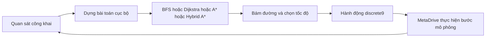

# Báo cáo nhóm thuật toán tìm kiếm trong mô phỏng xe tự hành

**Bàn giao cho Trí để tổng hợp báo cáo đề tài.** Ngày cập nhật: 26/11/2026. Mốc mã nguồn mô tả: `68ec4ddb617d6cd663ec27455e6288ca4c0603cc` trên `main`.

Nhóm Search của Stage 2 gồm **BFS, Dijkstra, A* và Hybrid A***. Bốn phương pháp đã được tích hợp vào nền tảng MetaDrive, dùng chung giao diện quan sát, bộ chuyển đổi hành động và quy trình ghi kết quả. Chúng thực hiện tìm kiếm khi xe đang chạy, không có giai đoạn huấn luyện mô hình.

Kết quả đánh giá lịch sử gồm **624 episode**, trong đó mỗi thuật toán chạy 96 case VALIDATION và 60 case TEST. Cả bốn phương pháp đều đạt **0/60 lần đến đích an toàn trên TEST**. BFS có tỷ lệ hoàn thành tuyến trung bình cao nhất trong bốn bản triển khai ở đợt này, đạt **78,67%**, nhưng chưa đạt mục tiêu hoàn thành an toàn toàn tuyến. Các con số này thuộc phiên bản agent **0.1.0**; phần triển khai hiện tại đã lên **0.2.1** và cần được đánh giá riêng.

## 1 Mục tiêu và phạm vi nghiên cứu

Mục tiêu của phần Search là xây dựng các phương pháp lập kế hoạch cục bộ làm cơ sở đối chiếu cho những hướng tiếp cận phức tạp hơn. Tại mỗi thời điểm quyết định, xe nhận trạng thái công khai, dựng một bài toán tìm đường ngắn hạn, tìm đường phù hợp và chuyển đường tìm được thành lệnh lái, ga hoặc phanh. Chất lượng phải được xem xét ở cả hai cấp: hiệu quả tìm kiếm cục bộ và khả năng điều khiển xe đi hết tuyến.

Ba câu hỏi nghiên cứu chính là:

1. Thay đổi thứ tự mở rộng nút giữa BFS, Dijkstra và A* ảnh hưởng thế nào khi giữ cùng đồ thị và controller?
2. Việc đưa hướng xe và mô hình chuyển động vào Hybrid A* đem lại đặc điểm gì về đường đi và chi phí tính toán?
3. Vì sao tìm được đường cục bộ vẫn có thể dẫn đến hết thời gian, ra khỏi đường hoặc va chạm trong mô phỏng?

**Graph search** là tên của nhóm kỹ thuật tìm kiếm trên đồ thị, không phải thuật toán thứ năm. A* dùng heuristic học được thuộc **Stage 6**, còn MCTS và MPPI nằm ở nhóm lập kế hoạch dựa trên mô phỏng của **Stage 3**. Những phương pháp đó không được gộp vào bảng so sánh bốn thuật toán Stage 2 trong báo cáo này.

## 2 Bài toán đầu vào và đầu ra

### 2.1 Quan sát công khai

Bốn agent nhận `AgentInputV1` với profile `STATE_DECISION_V1`. Hệ tọa độ cục bộ đặt tại xe: trục `+x` hướng về phía trước, trục `+y` hướng sang trái. Các thành phần liên quan gồm:

| Thành phần | Dữ liệu cung cấp | Cách nhóm Search sử dụng |
|---|---|---|
| `CoreObservationV1` | Vector 259 chiều, gồm 240 giá trị LiDAR | Controller đọc tốc độ xe; các planner đang xét không trực tiếp dựng bản đồ vật cản từ LiDAR |
| `TrafficContextV1` | Mảng tối đa 8 actor, mỗi actor có 7 thuộc tính và mask hợp lệ | Vị trí, vận tốc tương đối, hướng và kích thước actor phục vụ kiểm tra vật cản hoặc hạn chế tốc độ |
| `TaskContextV1` | Mặc định 20 waypoint dạng `(x, y, heading)`, mask hợp lệ và bề rộng làn hiện tại | Planner lấy tối đa 10 waypoint để dựng đồ thị hoặc vùng đường tham chiếu |

Agent không nhận đối tượng simulator sống, bản đồ toàn cục của evaluator, quỹ đạo tương lai thật, reward, split/case ID, tỷ lệ hoàn thành tuyến hoặc cờ kết thúc. Điều này giới hạn thuật toán vào thông tin quan sát được qua giao diện công khai. Chi tiết cấu trúc nằm trong [agent_input.py](../src/platform/agent_input.py).

### 2.2 Hành động điều khiển

Đầu ra của cả bốn agent đi qua `discrete9_lowbranch_v1`, gồm chín tổ hợp từ:

- Steering: `[-0.6, 0.0, 0.6]`.
- Ga/phanh: `[-0.8, 0.0, 0.6]`.

Chỉ số hành động được tính bằng `action = throttle_index * 3 + steer_index`. Hành động `1` tương ứng giữ hướng lái ở giữa và phanh `-0.8`; agent dùng hành động này khi thiếu đường tham chiếu hoặc không tìm được đường. Quy tắc ánh xạ được định nghĩa trong [action_adapter.py](../src/platform/action_adapter.py).

### 2.3 Luồng xử lý



Đây là cách lập kế hoạch lặp lại theo quan sát mới: đường tìm được ở một bước chỉ phục vụ điều khiển ngắn hạn. Một lần `PATH_FOUND` không chứng minh rằng xe sẽ đi hết tuyến hoặc không gặp va chạm ở bước tiếp theo.

## 3 Cơ sở thuật toán

### 3.1 BFS

BFS dùng hàng đợi FIFO, mở rộng các nút theo thứ tự số cạnh tính từ nút bắt đầu. Với đồ thị hữu hạn và đủ ngân sách tìm kiếm, đường đầu tiên đến đích có số cạnh nhỏ nhất. Khi trọng số cạnh khác nhau, tiêu chí này không đồng nghĩa với tổng chi phí nhỏ nhất.

Trong dự án, BFS vẫn cộng trọng số để báo chi phí của đường đã chọn, nhưng không dùng tổng trọng số đó để quyết định thứ tự duyệt. Cơ chế này được triển khai trong `breadth_first_search()` của [graph_search.py](../src/agents/graph_search.py).

Một đặc điểm quan trọng của lattice hiện tại là mọi đường từ gốc đến goal đều đi qua cùng số tầng waypoint. Vì vậy, nhiều đường có cùng số cạnh; thứ tự láng giềng cố định có thể quyết định đường BFS chọn. Không nên diễn giải kết quả của bản BFS này thành kết luận chung về mọi cách áp dụng BFS cho xe tự hành.

### 3.2 Dijkstra

Dijkstra ưu tiên mở rộng nút có chi phí tích lũy nhỏ nhất:

```text
g(v) = chi phí tốt nhất đã biết từ nút bắt đầu đến v
g_mới(v) = g(u) + c(u, v)
```

Nếu đường mới rẻ hơn, thuật toán cập nhật chi phí, nút cha và hàng đợi ưu tiên. Với trọng số không âm và đủ ngân sách, Dijkstra tìm đường có tổng chi phí nhỏ nhất trên đồ thị đã dựng. Nguồn học thuật gốc là [Dijkstra, 1959](https://link.springer.com/article/10.1007/BF01386390); bản triển khai của dự án nằm ở `dijkstra_search()` trong [graph_search.py](../src/agents/graph_search.py).

### 3.3 A*

A* bổ sung ước lượng chi phí còn lại vào chi phí đã đi:

```text
f(n) = g(n) + h(n)
h(n) = khoảng cách Euclidean từ n đến goal cục bộ
```

Heuristic hướng quá trình mở rộng về phía đích. Tính tối ưu cần gắn với điều kiện của heuristic và cách xử lý trạng thái; không thể mặc định mọi heuristic đều bảo đảm tối ưu. Cơ sở học thuật là [Hart, Nilsson và Raphael, 1968](https://doi.org/10.1109/TSSC.1968.300136).

Trong lattice của dự án, mỗi chi phí cạnh không nhỏ hơn chiều dài hình học của cạnh. Do đó, khoảng cách thẳng đến goal là một cận dưới phù hợp với hàm chi phí này. BFS, Dijkstra và A* dùng cùng đồ thị; A* khác Dijkstra ở ưu tiên `g + h` thay cho `g`. Xem `astar_search()` trong [planning_graph.py](../src/agents/planning_graph.py).

### 3.4 Hybrid A*

Hybrid A* trong dự án tìm trên pose liên tục `q = (x, y, theta)`. Nút kế tiếp được tạo bằng cách cho mô hình bicycle di chuyển một cung với góc lái cố định. Pose thật được giữ để truy vết, còn khóa rời rạc `(bin_x, bin_y, bin_heading)` dùng để phát hiện trạng thái trùng. Ý tưởng kết hợp trạng thái liên tục với ô tìm kiếm rời rạc được trình bày trong [Dolgov và cộng sự, 2008](https://ai.stanford.edu/~ddolgov/papers/dolgov_gpp_stair08.pdf).

Mô hình cục bộ dùng các quan hệ:

```text
dx/ds     = cos(theta)
dy/ds     = sin(theta)
dtheta/ds = tan(delta) / L
```

Trong đó `s` là quãng đường, `delta` là góc lái bánh trước của mô hình, `L` là wheelbase. Mã hiện tại tích phân cung giải tích rồi lấy mẫu dọc cung để kiểm tra hình học.

Biến thể đã triển khai chỉ cho xe tiến, kiểm tra footprint và có ngân sách tìm kiếm hữu hạn. Nó chưa có analytic expansion Reeds–Shepp/Dubins hay bước tối ưu làm mượt sau tìm kiếm. Việc gộp trạng thái vào bin và giới hạn mở rộng cũng khiến không thể áp nguyên bảo đảm tối ưu của A* trên đồ thị cố định cho toàn bộ bài toán Hybrid A* liên tục. Chi tiết nằm trong [hybrid_astar.py](../src/agents/hybrid_astar.py).

### 3.5 So sánh đặc điểm

| Phương pháp | Ưu tiên mở rộng | Mục tiêu cục bộ | Điểm cần lưu ý |
|---|---|---|---|
| BFS | FIFO | Ít cạnh nhất | Không tối ưu tổng trọng số; lattice có nhiều đường đồng hạng |
| Dijkstra | `g` nhỏ nhất | Tổng chi phí cạnh nhỏ nhất | Không có heuristic dẫn hướng |
| A* | `g + h` nhỏ nhất | Tổng chi phí cạnh với heuristic | Hiệu quả phụ thuộc heuristic và cấu trúc đồ thị |
| Hybrid A* | `g + h` trên các pose | Chi phí cung chuyển động | Thêm hướng xe, footprint và mô hình chuyển động; tốn tính toán hơn trong số liệu TRAIN lịch sử |

Với đồ thị tường minh có `V` nút và `E` cạnh, BFS có độ phức tạp `O(V + E)`. Với heap nhị phân trên đồ thị thưa, Dijkstra thường được mô tả bằng `O((V + E) log V)`; A* có thể giảm số nút thực tế nhờ heuristic nhưng không mặc nhiên có thời gian tốt hơn trong mọi trường hợp. Những biểu thức này không bao gồm chi phí dựng cảnh, kiểm tra hình học, bám đường hoặc mô phỏng xe.

## 4 Thiết kế đã triển khai trong dự án

### 4.1 Đồ thị chung cho BFS Dijkstra và A*

`build_planning_graph()` lấy tối đa 10 waypoint hợp lệ. Ở mỗi waypoint, nó tạo ba vị trí ngang danh định `[-0.8, 0, 0.8]` m theo pháp tuyến của đường; độ lệch được giới hạn theo bề rộng làn công khai. Thêm nút gốc tại vị trí xe tạo thành tối đa **31 nút** khi có đủ 10 waypoint.

Cạnh chỉ nối từ tầng hiện tại sang tầng tiếp theo. Từ một nút thông thường, xe được đi sang vị trí ngang hiện tại hoặc vị trí kề bên; không nhảy trực tiếp từ biên trái sang biên phải trong một tầng. Khi không bị vật cản loại cạnh, cấu trúc này có tối đa 66 cạnh với 10 tầng.

Chi phí một cạnh là:

```text
c(u, v) = max(khoảng_cách(u, v), 0.001)
          + 0.5 * |độ_lệch_ngang(v) - độ_lệch_ngang(u)|
          + 0.2 / (1 + khoảng_cách_tới_tâm_actor_gần_nhất(v))
```

Đồ thị loại các nút nằm trong hình chữ nhật actor đã mở rộng biên 0,5 m và lấy năm điểm trên mỗi cạnh để kiểm tra giao cắt. Đây là xấp xỉ hình học bằng các điểm lấy mẫu; nó không kiểm tra toàn bộ thân xe liên tục như một bộ kiểm chứng va chạm hoàn chỉnh.

Goal là vị trí giữa tại waypoint cuối của cửa sổ quan sát. Nó là đích cục bộ và tiếp tục thay đổi theo vị trí xe, không phải điểm kết thúc toàn bộ episode.

### 4.2 Tìm kiếm và xử lý thất bại

Mã giả sau mô tả ba thuật toán trên cùng đồ thị:

```text
Đưa nút bắt đầu vào frontier; lưu chi phí 0
Trong khi frontier còn phần tử và chưa hết ngân sách:
    BFS: lấy nút đầu hàng đợi
    Dijkstra: lấy nút có g nhỏ nhất
    A*: lấy nút có g + h nhỏ nhất
    Nếu là goal: truy vết parent và trả đường
    Xét các cạnh sang tầng tiếp theo
    BFS: thêm láng giềng chưa được khám phá
    Dijkstra/A*: cập nhật nếu tìm được g nhỏ hơn
Nếu không tới goal: trả kết quả không tìm thấy đường
```

Giới hạn chung là 256 nút mở rộng. Nếu không có đường tham chiếu, agent ghi `NO_PUBLIC_ROUTE`; nếu tìm kiếm không thành công, nó ghi `NO_PATH` và phanh. `NO_PATH` có thể xuất phát từ ràng buộc hình học hoặc hết không gian tìm kiếm; không được tự suy ra rằng xe chắc chắn đã va chạm.

### 4.3 Tham số và chi phí Hybrid A*

| Tham số | Giá trị hiện tại |
|---|---:|
| Chiều dài motion primitive | 1,5 m |
| Khoảng cách mẫu kiểm tra trên cung | Không quá 0,25 m |
| Độ phân giải khóa XY | 0,5 m |
| Số bin heading | 72 |
| Steering nội bộ chuẩn hóa | `0, -0.3, 0.3, -0.6, 0.6` |
| Góc lái chuẩn hóa theo | 60 độ |
| Wheelbase mô hình | 2,5 m |
| Footprint danh định | 4,6 × 1,9 m |
| Dung sai vị trí goal | 1,2 m |
| Dung sai hướng goal | 20 độ |
| Biên dự trữ làn | 0,1 m |
| Biên mở rộng actor | 0,25 m |
| Hệ số phạt steering | 0,1 |
| Hệ số phạt bình phương lệch tâm làn | 0,4 |

Các giá trị hình học nằm trong [search_planners_v1.json](../configs/experiments/search_planners_v1.json); hệ số lệch tâm làn nằm trong mã nguồn. Chi phí cung của bản hiện tại là:

```text
c_cung = 1.5 * (1 + 0.1 * |steering| + 0.4 * lệch_tâm_làn_ở_cuối_cung^2)
```

Heuristic hiện tại lấy khoảng cách đến vùng goal rồi làm tròn lên theo số cung tối thiểu:

```text
d = max(0, khoảng_cách_đến_tâm_goal - 1.2)
h = ceil(d / 1.5) * 1.5
```

Mỗi pose lấy mẫu được kiểm tra bốn góc thân xe trong hành lang đường và kiểm tra giao nhau với hình chữ nhật actor có hướng bằng SAT. Actor trong planner được giữ tại trạng thái quan sát hiện thời. Bản hiện tại cho phép cung đầu tiên phục hồi từ vùng biên dự trữ nếu thân xe vẫn nằm trong toàn bề rộng làn, nhưng cuối cung phải quay lại hành lang thông thường và mọi mẫu vẫn phải tránh actor.

Mã giả của Hybrid A*:

```text
Tạo cảnh từ waypoint, bề rộng làn và actor công khai
Kiểm tra pose gốc và điều kiện phục hồi từ biên làn
Đưa pose gốc vào frontier với g = 0
Trong khi còn frontier và còn ngân sách:
    Lấy pose có g + h nhỏ nhất
    Nếu đạt cả dung sai vị trí và hướng: truy vết các cung
    Với mỗi steering trong năm mức:
        Tích phân cung bicycle và lấy mẫu dọc cung
        Loại cung vi phạm hành lang hoặc giao actor
        Tính chi phí mới và khóa bin của pose cuối
        Nếu rẻ hơn trạng thái đang lưu ở bin: thêm pose mới
Nếu không đạt goal: trả NO_PATH
```

### 4.4 Bộ bám đường hiện tại

Cả bốn agent Stage 2 phiên bản 0.2.1 dùng `follow_stage2_path()` trong [path_following.py](../src/agents/path_following.py). Controller nội suy điểm bám cách 4,5 m dọc đường cục bộ, dùng quan hệ kiểu pure pursuit để tính steering, sau đó lượng tử hóa về ba mức lái với deadband 0,065.

Tốc độ từ observation được đổi theo `speed_kmh = observation_speed * 81 - 1`, phù hợp với cấu hình xe chuẩn hóa theo 80 km/h đang dùng. Với `target_normalized_speed = 0.15`, tốc độ mục tiêu cơ sở là 11,15 km/h. Controller có thể nhân 1,10 khi đường phía trước gần thẳng hoặc nhân 0,65 khi góc tới điểm bám lớn hơn 0,25 rad.

Để xử lý giao thông, controller dự đoán vị trí actor ở các mốc `0; 0.4; 0.8; 1.2` giây, kiểm tra khoảng trống theo đường cục bộ và giới hạn tốc độ bằng mô hình phản ứng/phanh. Tham số đang dùng là khoảng đệm 2 m, thời gian phản ứng 0,5 giây và giảm tốc giả định 2,5 m/s². Đây là cơ chế điều khiển gần đúng, không phải bảo đảm an toàn đã chứng minh.

File [astar_learning_v1.json](../configs/experiments/astar_learning_v1.json) vẫn chứa `control_lookahead_m = 6.0` và `steering_deadband = 0.12` của bộ bám đường cũ. Stage 2 hiện dùng các giá trị trong `STAGE2_CONTROL` nêu trên; Stage 6 learned A* vẫn chọn `follow_local_path()` cũ. Khi mô tả thí nghiệm, cần dùng đúng snapshot controller được ghi trong run.

## 5 Thiết kế thực nghiệm và chỉ số

### 5.1 Đợt đánh giá lịch sử

Đợt mang nhãn `search_planners_20261101` chạy trên nguồn đóng băng `63b36c851f7a4bb2c246705573ba5268c61fa8b1`, tree `1d5393bc90c3726276854d7f0ee23758d0b3de86`, agent phiên bản 0.1.0. Nhật ký UTC ghi ngày 31/10/2026; nhãn run và thời gian theo Việt Nam tương ứng đợt 01/11/2026.

Mỗi thuật toán chạy 96 episode VALIDATION và 60 episode TEST, tổng cộng `4 * (96 + 60) = 624`. Môi trường ghi nhận MetaDrive **0.4.3**, commit **85e5dadc6c7436d324348f6e3d8f8e680c06b4db**. Cả tám run có trạng thái COMPLETE và integrity VERIFIED; TEST được chạy sau khi toàn bộ VALIDATION hoàn tất, không đổi phương pháp giữa hai bộ theo hồ sơ campaign.

Bộ chia, hình học, seed, mật độ giao thông và horizon lấy từ protocol đã khóa. Với MapSuite V1, cần phân biệt metadata lịch sử khai báo hai làn với hình học thực tế dựng theo cấu hình hiệu lực ba làn. Danh tính benchmark dựa trên cấu hình hình học đã đóng băng và hash; không tự đổi số làn để tái tạo. Xem [đính chính metadata làn](environment/MAPSUITE_V1_LANE_METADATA_ERRATUM.md).

### 5.2 Định nghĩa chỉ số

| Chỉ số | Cách hiểu |
|---|---|
| Clean Success Rate | Số episode được phân loại đến đích an toàn chia tổng episode |
| Safety Failure Rate | Tỷ lệ episode có lỗi an toàn theo protocol, gồm các loại va chạm hoặc ra khỏi đường |
| Mean Route Completion | Trung bình tỷ lệ hoàn thành tuyến cuối episode |
| Median Route Completion | Trung vị tỷ lệ hoàn thành tuyến cuối episode |
| Path Found Rate | Tỷ lệ quyết định planner báo tìm được đường cục bộ; dùng trong phân tích diagnostic TRAIN |
| Expanded Nodes | Số nút mở rộng trong mỗi quyết định |
| `act()` median và p95 | Trung vị và phân vị 95 của thời gian gọi agent, tính cả dựng bài toán, tìm kiếm và điều khiển |

Phân loại episode ưu tiên lỗi an toàn trước đến đích. `COMPLETE` mô tả việc run đã ghi xong kết quả; `VERIFIED` mô tả kiểm tra integrity, không phải chứng nhận chất lượng lái. Các giá trị timing có observer hoặc render không được coi là thời gian thuần của thuật toán search.

## 6 Kết quả VALIDATION và TEST lịch sử

### 6.1 VALIDATION

| Thuật toán | Episode | Đến đích an toàn | Lỗi an toàn | Mean route | Median route |
|---|---:|---:|---:|---:|---:|
| BFS | 96 | 8/96 — 8,33% | 11/96 — 11,46% | 76,32% | 94,26% |
| Dijkstra | 96 | 0/96 — 0,00% | 96/96 — 100,00% | 4,85% | 4,36% |
| A* | 96 | 0/96 — 0,00% | 96/96 — 100,00% | 4,85% | 4,36% |
| Hybrid A* | 96 | 0/96 — 0,00% | 0/96 — 0,00% | 0,93% | 0,84% |

### 6.2 TEST

| Thuật toán | Episode | Đến đích an toàn | Lỗi an toàn | Mean route | Median route |
|---|---:|---:|---:|---:|---:|
| BFS | 60 | 0/60 — 0,00% | 4/60 — 6,67% | 78,67% | 94,31% |
| Dijkstra | 60 | 0/60 — 0,00% | 60/60 — 100,00% | 22,87% | 17,09% |
| A* | 60 | 0/60 — 0,00% | 60/60 — 100,00% | 22,87% | 17,09% |
| Hybrid A* | 60 | 0/60 — 0,00% | 15/60 — 25,00% | 32,30% | 19,32% |

Nguồn trực tiếp của hai bảng là [metrics.json](../results/search_planners_20261101/metrics.json); phần mô tả campaign nằm trong [báo cáo kết quả lịch sử](../results/search_planners_20261101/README.md). Bản sao episode CSV, summary và manifest của các run TEST còn nằm ở [thư mục tổng hợp ngày 21/11](../results/result-21-11-2026/README.md). Ngày đóng gói này không làm chúng trở thành lượt chạy search mới ngày 21/11.

### 6.3 Nhận xét kết quả

**BFS tiến được xa nhưng chưa hoàn thành mục tiêu TEST.** Mean route 78,67% và median 94,31% cho thấy nhiều episode đi được phần lớn tuyến. Tuy nhiên, tỷ lệ đến đích an toàn vẫn bằng 0%. Không thể thay tiêu chí đến đích bằng tỷ lệ hoàn thành tuyến để tuyên bố thành công.

**A* và Dijkstra có metric tổng hợp giống nhau trong đợt này.** Việc dùng heuristic có thể thay số nút mở rộng mà vẫn trả cùng đường. Chỉ riêng bảng metric chưa chứng minh nguyên nhân thất bại nằm ở thuật toán tìm kiếm; cần xem đường đã chọn, controller và diễn biến xe.

**Hybrid A* có tỷ lệ lỗi an toàn thấp trên VALIDATION nhưng tiến độ cũng rất thấp.** Hai chỉ số phải được đọc cùng nhau: một xe gần như không tiến lên có thể ít gặp lỗi an toàn mà vẫn không hoàn thành nhiệm vụ. Chênh lệch VALIDATION/TEST ở đây mô tả hai tập case của một bản triển khai, không chứng minh khả năng tổng quát hóa tốt.

Các phương pháp deterministic chỉ có một lượt cho mỗi case trong campaign này. Do đó, chưa có cơ sở từ các bảng trên để kết luận ưu thế thống kê hoặc khẳng định một thuật toán luôn tốt hơn thuật toán khác.

## 7 Các nghiên cứu thăm dò trên TRAIN

Hai nghiên cứu dưới đây phục vụ chẩn đoán và thử cải tiến, tách khỏi kết quả VALIDATION/TEST ở mục 6. Bằng chứng gốc hiện nằm trong `artifacts/` cục bộ và bị Git ignore; báo cáo này bàn giao phần tổng hợp, không kèm toàn bộ raw runs của hai nghiên cứu trong một bản clone mới.

### 7.1 Baseline TRAIN ngày 12 tháng 11

Lịch thử chọn 12 geometry TRAIN, một geometry cho mỗi scenario family, ba geometry ở mỗi mức Easy, Medium, Hard và Extreme; environment seed đều bằng 0. Bốn thuật toán chạy cùng panel, tạo 48 episode. Nguồn ghi trong báo cáo baseline là `74f4874e82c8ad9b0c06db2ffa31649f95cf8895`.

| Thuật toán | Episode | Đến đích an toàn | Lỗi an toàn | Mean route | Path found | Node mở rộng TB | `act()` median / p95 ms |
|---|---:|---:|---:|---:|---:|---:|---:|
| BFS | 12 | 0/12 | 2/12 | 74,50% | 80,87% | 29,47 | 4,599 / 24,695 |
| Dijkstra | 12 | 0/12 | 12/12 | 31,79% | 98,69% | 28,99 | 4,428 / 11,721 |
| A* | 12 | 0/12 | 12/12 | 31,79% | 98,69% | 11,89 | 4,467 / 12,235 |
| Hybrid A* | 12 | 0/12 | 8/12 | 40,34% | 62,43% | 74,07 | 92,813 / 169,482 |

Nguồn cục bộ: `artifacts/train_search_20261112/KET_QUA.md`, `aggregates.json`, `verification.json` và `NHAN_XET.md` trong cùng thư mục.

A* mở rộng trung bình ít nút hơn Dijkstra, khoảng **58,98%**, tính từ các giá trị chưa làm tròn trong `aggregates.json`, nhưng thời gian `act()` không giảm tương ứng. Đây là dấu hiệu cần tách chi phí dựng graph và điều khiển khỏi riêng search khi phân tích hiệu năng.

Diagnostic lưu nhận xét A* và Dijkstra có chuỗi hành động trùng nhau trên 12/12 map. Hybrid A* có 47,31% quyết định vượt 100 ms trong panel này; nhiều lần `NO_PATH` bị loại ngay tại pose gốc trước khi mở rộng. Các quan sát đó mô tả baseline TRAIN lịch sử, không phải phép đo timing của phiên bản 0.2.1 hiện tại.

### 7.2 Thử cải tiến TRAIN ngày 18 tháng 11

Nghiên cứu tiếp theo gồm tám lượt replay/thử nhỏ và 48 episode chạy biến thể trên cùng panel TRAIN. Các biến thể được nạp qua runner nghiên cứu cục bộ tại thời điểm đó.

| Thuật toán | Đến đích an toàn gốc → biến thể | Lỗi an toàn gốc → biến thể | Mean route gốc → biến thể | Case mới phát sinh lỗi an toàn |
|---|---:|---:|---:|---:|
| BFS | 0/12 → 3/12 | 2/12 → 2/12 | 74,50% → 78,67% | 1 |
| Dijkstra | 0/12 → 0/12 | 12/12 → 12/12 | 31,79% → 31,85% | 0 |
| A* | 0/12 → 0/12 | 12/12 → 12/12 | 31,79% → 31,85% | 0 |
| Hybrid A* | 0/12 → 5/12 | 8/12 → 3/12 | 40,34% → 65,45% | 1 |

Nguồn cục bộ: `artifacts/search_followup_20261118/KET_QUA.md`, `verification.json` và `so_sanh_theo_case.csv`.

Tổng số lần đến đích an toàn tăng từ 0/48 lên 8/48, nhưng có hai case mới chuyển sang va chạm: BFS trên `Extreme/SCXOCrTYCS` và Hybrid A* trên `Hard/XTOCS`. Tổng lỗi BFS vẫn bằng hai không có nghĩa tập case lỗi không đổi. Vì vậy, tăng tiến độ hoặc số lần đến đích cần được đối chiếu với thay đổi an toàn theo từng cặp case.

Replay A* cho thấy một lệnh lái tính được khoảng `-0.119686` bị deadband 0,12 đưa về lái thẳng. Thử hạ deadband giúp xe đi xa hơn ở case đó nhưng vẫn ra khỏi đường. Với Hybrid A*, một ca ghi khoảng cách góc thân xe 1,6517 m so với ngưỡng corridor 1,6500 m, dẫn đến chuỗi phanh do không qua kiểm tra pose gốc. Đây là bằng chứng chẩn đoán ở các ca cụ thể, không đủ để gán mọi thất bại của thuật toán cho cùng một nguyên nhân.

### 7.3 Quan hệ với phiên bản hiện tại

Phiên bản 0.2.1 hiện có controller nội suy điểm bám, deadband mới, tăng tốc có điều kiện trên đường thẳng, hạn chế tốc độ theo actor, cùng thay đổi lane-centering và phục hồi biên của Hybrid A*. Đây là tập thay đổi rộng hơn các biến thể TRAIN ngày 18/11. **Không gán kết quả 8/48 của nghiên cứu thăm dò cho phiên bản 0.2.1**, và không dùng lại bảng TEST cũ để đại diện cho hiệu quả của controller mới.

## 8 Đánh giá ưu điểm hạn chế và hướng phát triển

### 8.1 Những phần đã đạt được

Nhóm đã xây dựng bốn agent độc lập về phương pháp nhưng thống nhất về giao diện thực thi; các run ghi được cấu hình planner, phiên bản, hash và diagnostic. Thiết kế chung của BFS/Dijkstra/A* cho phép phân tích ảnh hưởng của chiến lược tìm kiếm trên cùng graph. Hybrid A* đã đưa hướng xe và footprint vào quá trình sinh đường cục bộ.

Workbench, viewer và bảng Agent I/O hỗ trợ quan sát input, đường điều khiển và trạng thái planner. Các công cụ này có ích cho giải thích và chẩn đoán; chất lượng hình ảnh hoặc việc xe chạy được trong demo không thay thế phép đo hoàn thành an toàn theo protocol.

### 8.2 Hạn chế hiện tại

- **Tầm nhìn cục bộ và biểu diễn thô:** lattice chỉ xét một cửa sổ waypoint và ba vị trí ngang; nó không giải bài toán điều hướng toàn cục hoặc chiến lược giao thông dài hạn.
- **Xấp xỉ vật cản:** graph kiểm tra điểm lấy mẫu; Hybrid A* giữ actor tĩnh trong search; controller có dự đoán ngắn nhưng chưa tạo một planner có không gian thời gian đầy đủ. Các planner không khai thác trực tiếp LiDAR để lập occupancy map.
- **Khoảng cách giữa planning và control:** đường hình học hợp lệ vẫn có thể khó bám với hành động discrete9, quán tính và sai số mô hình thực tế của MetaDrive.
- **Ngân sách tính toán:** Hybrid A* phải kiểm tra nhiều pose và footprint; timing TRAIN lịch sử cho thấy cần kiểm soát độ trễ. Không suy ra thời gian hiện tại từ dữ liệu của bản cũ hoặc từ FPS của Race Mode.
- **Phạm vi bằng chứng:** kết quả lịch sử chưa đạt thành công TEST; dữ liệu TRAIN chỉ dùng một geometry/seed cho mỗi family; chưa có bảng đánh giá đầy đủ của bản 0.2.1 trong các nguồn đã tổng hợp ở đây.

### 8.3 Hướng thử nghiệm tiếp theo

| Hạng mục đề xuất | Thiết kế kiểm chứng | Chỉ số cần đối chiếu |
|---|---|---|
| Ablation controller | Giữ planner, case và seed; lần lượt đổi nội suy, deadband, tốc độ và phanh actor trên TRAIN | Clean success, lỗi an toàn, sai số bám đường, outcome theo từng cặp case |
| Chẩn đoán Hybrid A* | Tách nguyên nhân `NO_PATH` tại gốc, không còn frontier và chạm ngân sách | Tỷ lệ từng nguyên nhân, tiến độ, thời gian đứng yên |
| Đo riêng chi phí tính toán | Tách dựng scene/graph, search, controller và rendering | Median/p95 latency từng phần, tỷ lệ vượt chu kỳ 100 ms |
| Thử vật cản động | Dùng cùng tình huống giao cắt và seed, so mô hình tĩnh với dự đoán ngắn | Va chạm, phanh gấp và tiến độ |
| Đánh giá bản 0.2.1 | Đóng băng source/config sau khi hoàn tất điều chỉnh trên TRAIN | Đầy đủ provenance, coverage và metric theo quy trình đánh giá được chấp thuận |

Đây là các hướng đề xuất, chưa phải kết quả thực nghiệm đã đạt. TEST cũ đã được quan sát; nếu tiếp tục điều chỉnh dựa trên lỗi của TEST, một lần chạy lại không trở thành holdout độc lập mới. Cần ghi rõ chính sách sử dụng dữ liệu và phiên bản giao thức trong báo cáo tiếp theo.

## 9 Chạy lại và tìm bằng chứng trong repository

Các lệnh dưới đây chạy từ **thư mục gốc repository**, với môi trường `.venv/metadrive` đã được cài theo hướng dẫn dự án.

Xem lịch cố định bốn thuật toán trên TRAIN mà chưa chạy simulator:

```powershell
& '.\.venv\metadrive\python.exe' -B autonomous-driving-rl/experiments/compare_search_planners.py
```

Chạy lịch TRAIN đó bằng launcher:

```powershell
& '.\.venv\metadrive\python.exe' -B autonomous-driving-rl/experiments/compare_search_planners.py --run
```

Xem lịch nghiên cứu lại trên panel 12 family TRAIN; mặc định chưa chạy thật:

```powershell
& '.\.venv\metadrive\python.exe' -B autonomous-driving-rl/experiments/recheck_search_planners.py
```

Viewer có lịch VALIDATION/TEST và lưu kết quả trực quan riêng. Chỉ mở khi cần minh họa hoặc chẩn đoán có chủ đích; nó không khôi phục nguyên trạng campaign cũ:

```powershell
& '.\.venv\metadrive\python.exe' -B -u autonomous-driving-rl/scripts/view_search_planners.py
```

Race Mode mở qua `CHAY_DUA_XE.cmd`, có thể cho nhiều xe chạy đồng thời. Vị trí xuất phát khác nhau, tương tác giữa xe, giới hạn luật đua và worker bất đồng bộ làm nó khác phép so sánh từng agent với cùng điều kiện ban đầu. Chọn một bản đồ TEST trong Race Mode không tự tạo kết quả benchmark chuẩn.

| Nguồn trong Git | Nội dung dùng cho báo cáo |
|---|---|
| [graph_search.py](../src/agents/graph_search.py) | BFS và Dijkstra |
| [planning_graph.py](../src/agents/planning_graph.py) | Đồ thị chung, chi phí cạnh và A* |
| [astar_agent.py](../src/agents/astar_agent.py) và [graph_search_agents.py](../src/agents/graph_search_agents.py) | Agent ID, phiên bản, dispatch controller |
| [hybrid_astar.py](../src/agents/hybrid_astar.py) và [hybrid_astar_agent.py](../src/agents/hybrid_astar_agent.py) | Pose, motion primitive, hình học, heuristic và chi phí |
| [path_following.py](../src/agents/path_following.py) | Bộ bám đường Stage 2 hiện tại và bộ cũ dùng cho Stage 6 |
| [registry.py](../src/launcher/registry.py) | Đăng ký bốn candidate; tại mốc báo cáo đều có `benchmark_eligible=False` |
| [metrics.json](../results/search_planners_20261101/metrics.json) | Tám run, 624 episode, metrics và provenance của đánh giá lịch sử |
| [Kết quả TEST đã đóng gói](../results/result-21-11-2026/README.md) | Bản sao dữ liệu search cũ cùng kết quả candidate MPPI/Random riêng biệt |
| [test_search_planners.py](../tests/test_search_planners.py) | Kiểm tra thuật toán, hình học, controller và tích hợp |
| [SEARCH_VISUAL_VIEWER.md](SEARCH_VISUAL_VIEWER.md) | Viewer và cách đọc log trực quan |

## 10 Đoạn kết luận có thể dùng trong báo cáo tổng hợp

Trong phần nghiên cứu các thuật toán tìm kiếm, nhóm triển khai BFS, Dijkstra, A* và Hybrid A* trên nền tảng mô phỏng xe tự hành MetaDrive. BFS, Dijkstra và A* dùng chung đồ thị waypoint có các lựa chọn độ lệch ngang, trong khi Hybrid A* tìm trên trạng thái vị trí và hướng xe bằng các cung chuyển động bicycle. Các phương pháp được tích hợp với cùng giao diện quan sát công khai, đầu ra discrete9 và cơ chế ghi provenance.

Đợt đánh giá lịch sử gồm 624 episode cho thấy các bản triển khai vẫn còn hạn chế khi thực hiện nhiệm vụ lái xe hoàn chỉnh. Trên 60 case TEST của mỗi phương pháp, cả bốn đều chưa có lần đến đích an toàn. BFS đạt mức hoàn thành tuyến trung bình 78,67%, cao hơn ba phương pháp còn lại trong đợt này, nhưng tỷ lệ hoàn thành tuyến không thay thế tỷ lệ đến đích an toàn. Phân tích TRAIN cho thấy A* có thể giảm số nút mở rộng so với Dijkstra mà vẫn tạo cùng hành vi điều khiển; các vấn đề bám đường, lượng tử hóa steering, tốc độ và điều kiện hình học của Hybrid A* cần được xét cùng với bản thân thuật toán search.

Phiên bản hiện tại đã bổ sung các thay đổi ở bộ bám đường, giới hạn tốc độ theo actor và xử lý hình học của Hybrid A*. Hiệu quả của phiên bản này cần được đánh giá bằng một thí nghiệm có source/config đóng băng và phân biệt rõ với dữ liệu lịch sử. Hướng phát triển tiếp theo là thực hiện ablation trên TRAIN, phân tích an toàn theo từng case và đo riêng chi phí dựng bài toán, tìm kiếm và điều khiển.

## 11 Tài liệu học thuật tham khảo

1. E. W. Dijkstra, **A note on two problems in connexion with graphs**, *Numerische Mathematik*, 1, 269–271, 1959. [Trang nhà xuất bản](https://link.springer.com/article/10.1007/BF01386390).
2. P. E. Hart, N. J. Nilsson và B. Raphael, **A Formal Basis for the Heuristic Determination of Minimum Cost Paths**, *IEEE Transactions on Systems Science and Cybernetics*, 4(2), 100–107, 1968. [DOI](https://doi.org/10.1109/TSSC.1968.300136).
3. D. Dolgov, S. Thrun, M. Montemerlo và J. Diebel, **Practical Search Techniques in Path Planning for Autonomous Driving**, STAIR, 2008. [Bài báo từ Stanford](https://ai.stanford.edu/~ddolgov/papers/dolgov_gpp_stair08.pdf).

Các tài liệu học thuật giải thích nền tảng phương pháp; số liệu của đề tài lấy từ các file thực nghiệm của repository được dẫn ở từng mục.
