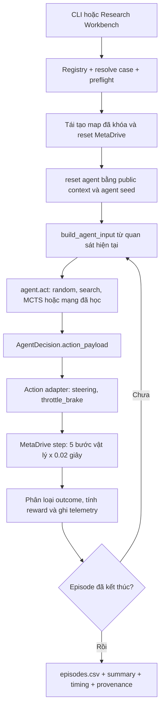
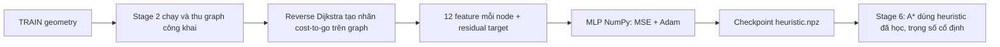
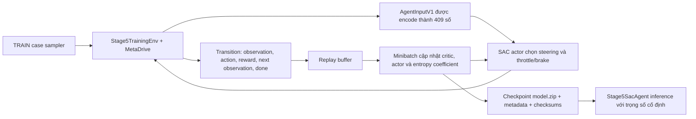

Tài liệu này giải thích dự án xe tự lái bằng cách đối chiếu với board game và chỉ ra những gì mã hiện tại thực sự triển khai. Bản đọc mã ngày 15/11/2026, trên nhánh `main`, HEAD `c2b964e`, có thay đổi cục bộ sẵn có trong `src/agents/MCTS_agent.py`. Những thay đổi đó được giữ nguyên. Đây là hướng dẫn học và vận hành, không phải chứng nhận chất lượng lái xe.

Điểm xuất phát là: **dự án đang giải bài toán ra quyết định tuần tự cho một xe, trên tuyến đường được cung cấp, bằng quan sát trạng thái có cấu trúc**. Xe phải tới đích an toàn trước khi hết thời gian. Mỗi quyết định điều khiển có hiệu lực trong 0,1 giây mô phỏng. MetaDrive quản lý chuyển động và giao thông; agent chọn điều khiển. Hình ảnh 3D là cách con người quan sát thí nghiệm; pipeline chính hiện tại không đưa ảnh camera vào neural network.

Các số Stage 0–7 là cách phân loại các phương pháp có thể nghiên cứu. Chúng không phải tám bước xử lý bắt buộc của mỗi quyết định, không bắt buộc thực hiện hết, và không bảo đảm stage sau lái tốt hơn stage trước.

Không nên chuyển nguyên giả định minimax từ game hai người sang dự án này. Các xe khác không được định nghĩa là một đối thủ zero-sum luân phiên cố làm xe ego thua. Trong MCTS hiện tại, bước backup vì thế không đảo dấu giá trị theo lượt người chơi.

Có thể viết bài toán môi trường dưới dạng `s[t+1] ~ P(. | s[t], a[t])`, `o[t] = O(s[t])`. Policy nhận `o[t]`, có thể giữ lịch sử riêng, rồi chọn `a[t]`. RL học cách tăng kỳ vọng tổng reward có chiết khấu. `s[t]` là trạng thái đầy đủ; `o[t]` là phần thông tin agent được cấp. Do chỉ thấy vùng lân cận và không thấy toàn bộ trạng thái simulator, không nên khẳng định vector hiện tại là trạng thái Markov đầy đủ. Góc nhìn quan sát một phần/POMDP chính xác hơn về mặt thông tin.

**259 chiều không có nghĩa là 259 trạng thái.** Nó nghĩa là mỗi quan sát lõi chứa 259 số. Các số có miền liên tục, nên không gian quan sát có vô số giá trị lý tưởng hóa. Tương tự, 409 chiều của SAC là kích thước một vector vào mạng; nó không phải số cảnh, số map hay số node trên cây tìm kiếm.

Luồng chạy thực tế nằm trong [executor.py](../src/launcher/executor.py), được CLI và GUI dùng chung:



Đây là vòng kín: quan sát mới sẽ sửa lại quyết định kế tiếp. Một đường cục bộ tìm được hoặc một rollout tốt chưa bảo đảm xe đi hết episode. Cũng cần phân biệt 0,1 giây **thời gian mô phỏng** với thời gian CPU thực sự dùng để tính một quyết định.

Interface của agent được định nghĩa tại [agent.py](../src/platform/agent.py):

```python
descriptor                       # Khai báo agent, profile, adapter, tính ngẫu nhiên...
reset(public_context, agent_seed) # Đặt lại trạng thái của episode
act(agent_input) -> AgentDecision # Chọn một quyết định
close()                          # Giải phóng tài nguyên
```

`reset()` không đồng nghĩa train lại. Với mạng đã học, trọng số được giữ cố định trong inference; bộ đếm, RNG hoặc hidden state theo episode được đặt lại. `act()` không được đọc trực tiếp live `env`, engine hoặc evaluator để lấy thêm thông tin.

Đầu vào chung được hiện thực tại [agent_input.py](../src/platform/agent_input.py). Profile chính là `STATE_DECISION_V1`:

| Thành phần                                         |          Kích thước | Ý nghĩa                                                                              |
| ---------------------------------------------------- | ---------------------: | -------------------------------------------------------------------------------------- |
| `core_observation.features`                        |             `(259,)` | 9 ego + 10 navigation + 240 LiDAR; float32, chuẩn hóa trong `[0,1]`                |
| `traffic_context.actors_array`                     |              `(8,7)` | Tối đa 8 xe trong bán kính 50 m, sắp theo khoảng cách                           |
| `traffic_context.validity_mask`                    |               `(8,)` | Slot nào có xe thật, slot nào là padding                                          |
| `traffic_context.active_count`, `overflow_count` |               2 scalar | Số xe được chọn và số xe trong vùng bị bỏ vì vượt capacity                |
| `task_context.waypoints_array`                     |             `(20,3)` | Mỗi waypoint là `(relative_x, relative_y, relative_heading)`                       |
| `task_context.validity_mask`                       |              `(20,)` | Những waypoint còn hợp lệ trên tuyến                                             |
| Task metadata                                        | Một số scalar/vector | Bề rộng làn, hướng checkpoint, cờ tuyến kết thúc trong cửa sổ nhìn trước |
| `step_index`                                       |              1 integer | Chỉ số quyết định trong episode                                                   |

Traffic và waypoint dùng hệ tọa độ gắn với ego: `+x` phía trước, `+y` bên trái. Bảy thuộc tính của một xe là `(x_rel, y_rel, vx_rel, vy_rel, heading_rel, length, width)`, với đơn vị vật lý m, m/s và radian. Không áp dụng quy tắc `[0,1]` của core cho toàn bộ traffic/task. Dữ liệu này được platform trích từ trạng thái simulator, không phải kết quả một hệ thống camera detection/tracking đã được xây dựng. Đây là giả định về thông tin của thí nghiệm và phải giữ giống nhau khi so sánh agent.

Có 20 waypoint cách nhau danh định 2,5 m dọc theo tuyến, nhìn trước tối đa 50 m. Route context cung cấp tham chiếu để bám tuyến; tọa độ của nó không phải quỹ đạo tương lai mà xe chắc chắn sẽ thực hiện. `route_end_within_lookahead=True` cũng không đồng nghĩa xe đã tới đích.

Trong phần ego, các chỉ số cần đọc đúng là:

| Index trong core | Ý nghĩa                                                              |
| ---------------: | ---------------------------------------------------------------------- |
|             0, 1 | Khoảng cách chuẩn hóa tới hai biên đường                      |
|                2 | Đại lượng chuẩn hóa biểu diễn lệch hướng so với làn       |
|                3 | Tốc độ chuẩn hóa                                                  |
|                4 | Góc lái hiện tại chuẩn hóa                                       |
|                5 | Thành phần steering của action trước                              |
|                6 | Thành phần throttle/brake của action trước                        |
|                7 | Đại lượng yaw-rate bị clip/chuẩn hóa theo native implementation |
|                8 | Độ lệch ngang so với tâm làn                                     |
|            9–18 | Thông tin navigation: hai checkpoint, mỗi checkpoint 5 thuộc tính  |
|          19–258 | 240 tia LiDAR                                                          |

Ở cấu hình tốc độ tối đa 80 km/h mà MCTS đang giả định, `core[3] = (speed_kmh + 1) / 81`. Vì vậy dừng xe là xấp xỉ `1/81`, không phải mặc định `0.5`. Giá trị `core[5]=0.5` giải mã thành steering trước bằng 0. LiDAR bằng 1 là không hit trong tầm đo 50 m; không nên xem đó là vật cản chắc chắn nằm tại 50 m. LiDAR này không cung cấp đầy đủ biên đường/vạch làn: collision mask của nó loại các đối tượng đó.

Một số comment trong `CoreObservationV1` mô tả ego/navigation quá sơ lược hoặc sai, ví dụ “5 relative checkpoint directions”. Bảng trên đối chiếu audit observation của repo với [source MetaDrive đúng commit pin](https://raw.githubusercontent.com/metadriverse/metadrive/85e5dadc6c7436d324348f6e3d8f8e680c06b4db/metadrive/obs/state_obs.py), thay vì suy diễn từ comment ấy.

Agent không được nhận `route_completion`, reward, cờ thành công/va chạm, split/case ID, environment seed hoặc future trajectory như feature đặc quyền. Evaluator vẫn đọc chúng để chấm và ghi log. Khi train RL, trainer nhận reward từ `env.step()` để cập nhật mạng; reward không vì thế trở thành một chiều đầu vào policy. Profile `CORE_ONLY_V1` là biến thể ablation, che traffic/task; SAC chính hiện tại dùng profile đầy đủ.

Đầu ra cuối cùng luôn là `[steering, throttle_brake]` trong `[-1,1]^2`. Throttle/brake dương là ga, âm là phanh; cấu hình chính tắt reverse. Đừng suy luận một lệnh phanh âm là lệnh lái lùi. Quy ước dấu steering cần đọc cùng hệ tọa độ và kiểm tra đáp ứng simulator; một số nhãn trái/phải trong comment của adapter không thống nhất với mô tả ở planner.

[action_adapter.py](../src/platform/action_adapter.py) có ba adapter: `continuous_box2_v1` nhận cặp số trực tiếp; `discrete25_native_v1` nhận index 0–24; `discrete9_lowbranch_v1` nhận index 0–8. Chín action là tích Descartes của steering `[-0.6,0,0.6]` và throttle/brake `[-0.8,0,0.6]`:

| Throttle/brake | Steering -0.6 | Steering 0 | Steering +0.6 |
| -------------- | ------------: | ---------: | ------------: |
| -0.8, phanh    |             0 |          1 |             2 |
| 0, thả trôi  |             3 |          4 |             5 |
| +0.6, ga       |             6 |          7 |             8 |

Ví dụ `AgentDecision(action_payload=7)` qua discrete9 trở thành `[0.0,0.6]`. SAC có thể trả thẳng `[0.12,0.35]` qua continuous adapter. Rời rạc hóa action giúp giảm số nhánh tìm kiếm nhưng không biến chuyển động xe thành game rời rạc hoàn toàn. Payload không hợp lệ bị từ chối; adapter không âm thầm clip output tùy ý.

Registry hiện tại có **8 agent nghiên cứu/candidate và 4 fixture**, xem [registry.py](../src/launcher/registry.py). Tất cả đang `benchmark_eligible=False`; có mã triển khai không đồng nghĩa đã được chứng nhận chạy benchmark chính thức.

| Nhóm bạn đang học           | Hiện có trong repo                                                           | Đầu ra / có cần train?         | Cách hiểu đúng                                                                            |
| ------------------------------- | ------------------------------------------------------------------------------ | ---------------------------------- | --------------------------------------------------------------------------------------------- |
| Stage 0 Random/Naive            | `stage0_random_naive`                                                        | Discrete9; không train            | Baseline ngẫu nhiên có thiên lệch và giữ action                                        |
| Stage 1 Rule-based              | Chưa có agent riêng được đăng ký                                      | Chưa có pipeline riêng          | Có logic heuristic trong controller/rollout, nhưng chưa thành baseline Stage 1 độc lập |
| Stage 2 Search                  | `stage2_bfs`, `stage2_dijkstra`, `stage2_astar`, `stage2_hybrid_astar` | Discrete9; không train            | Tìm đường cục bộ, sau đó bám đường                                                |
| Stage 3 Simulation planning     | `stage3_mcts`                                                                | Discrete9; không train trọng số | UCT + forward model viết tay + rollout có hướng dẫn                                      |
| Stage 4 NN / learning from data | Chưa có policy BC/imitation độc lập                                       | Chưa có trainer Stage 4 riêng   | MLP hiện có được dùng ở Stage 6; NN cũng có trong SAC                                |
| Stage 5 RL                      | `stage5_sac` + trainer SAC                                                   | Continuous2; cần checkpoint       | Model-free deep RL, actor–critic                                                             |
| Stage 6 Search + learning       | `stage6_astar_learned` + trainer heuristic                                   | Discrete9; cần checkpoint         | A* + MLP học heuristic bằng supervised learning                                             |
| AlphaGo/AlphaZero đầy đủ    | Chưa có                                                                      | Chưa có                          | Không đồng nhất learned A* với AlphaGo/AlphaZero                                         |
| Stage 7 / MuZero                | Chưa có world model học được hoặc MuZero agent                          | Chưa có                          | Mô hình bicycle viết tay của MCTS không phải MuZero                                     |

`fixture_constant_continuous`, `fixture_seeded_random`, `fixture_stateful_counter`, `fixture_discrete` dùng kiểm thử hạ tầng. Khi báo cáo baseline nghiên cứu, phải phân biệt chúng với `stage0_random_naive`.

[Random/Naive](../src/agents/random_naive_agent.py) không đọc observation. Đầu episode giữ action 7 trong 20 quyết định. Sau đó lấy mẫu steering với xác suất `0.2/0.6/0.2`, throttle/brake với xác suất `0.1/0.15/0.75`, rồi giữ action trong 20–40 quyết định. Như vậy mỗi action được giữ 2–4 giây mô phỏng, không phải uniform random mới ở mọi bước. RNG cục bộ dùng `agent_seed`, mặc định 42 nếu thiếu.

Ở [BFS/Dijkstra/A*](../src/agents/planning_graph.py), agent lấy tối đa 10 waypoint đầu, mỗi waypoint tạo ba vị trí ngang `[-0.8,0,0.8]` m, có clip theo bề rộng làn. Cộng node gốc, đồ thị có tối đa `1 + 10×3 = 31` node. Đây là **không gian tìm kiếm do planner dựng**, khác với không gian trạng thái thật và vector quan sát. Agent không nhận toàn bộ road-network graph để tìm đường toàn cục.

Mỗi cạnh tiến một tầng. Chi phí gồm độ dài, đổi vị trí ngang và clearance đối với xe quan sát được. Actor được xem như vật cản tại snapshot; graph này không dự đoán giao thông động và không sử dụng trực tiếp toàn bộ LiDAR. BFS chọn ít cạnh; Dijkstra chọn `g`; A* chọn `g+h` với `h` Euclidean. Trên lattice này mọi đường đến goal có cùng số tầng, nên BFS có nhiều nghiệm đồng hạng phụ thuộc thứ tự láng giềng. Tối ưu trên một graph xấp xỉ không bảo đảm tối ưu an toàn lái xe.

[path_following.py](../src/agents/path_following.py) chuyển path thành discrete9 bằng quy tắc bám điểm phía trước và điều khiển tốc độ. Vì vậy kết quả lái phụ thuộc cả biểu diễn graph, chi phí, khả năng tìm kiếm, bộ bám đường và action rời rạc. Một planner tìm được đường đúng trên graph vẫn có thể lái ra khỏi đường trong simulator.

[Hybrid A*](../src/agents/hybrid_astar.py) tìm trên pose liên tục `(x,y,heading)`, dùng bin XY/heading để gom trạng thái. Nó sinh cung bicycle tiến, kiểm tra footprint xe và corridor/actor. Bản hiện tại forward-only, chưa có đầy đủ mô hình trượt lốp hay dự đoán actor động. Đường bên trong được sinh bằng motion primitive; đầu ra vẫn đi qua path follower discrete9. Chi phí Hybrid A* khác chi phí lattice, nên không so trực tiếp hai con số `local_path_cost` như cùng một đơn vị mục tiêu.

[MCTS_agent.py](../src/agents/MCTS_agent.py) và [mcts_model.py](../src/agents/mcts_model.py) triển khai vòng nhìn trước. Mỗi lần `act()` dựng lại snapshot/cây từ quan sát mới:

1. Đọc tốc độ, steering trước, route waypoint, bề rộng làn, actor và LiDAR công khai.
2. Tạo `PlanningState(x,y,yaw,speed,time_s,last_steering)` trong hệ tọa độ cố định tại thời điểm bắt đầu quyết định.
3. Selection dùng UCT để cân bằng giá trị trung bình và khám phá.
4. Expansion thử một action chưa mở rộng bằng forward model.
5. Rollout chạy tiếp đến độ sâu còn lại; 90% dùng action heuristic, 10% lấy mẫu ngẫu nhiên theo cấu hình hiện tại.
6. Backup cộng reward từng cạnh và chiết khấu đúng một lần, cập nhật visits/return.
7. Chọn trong action gốc không dự đoán lỗi ngay bước đầu nếu có; ưu tiên số visits rồi mean return. Nếu không có lựa chọn đó, phanh thẳng.
8. Chỉ action được chọn mới được executor đưa vào `env.step()` thật.

Cấu hình mặc định là 64 iteration, sâu 20 quyết định, `gamma=0.98`, cửa sổ 2 giây khi `dt=0.1`. Mô hình bicycle tích phân tối đa 0,02 giây/lần; actor được dự đoán vận tốc không đổi trong frame gốc. Relative velocity được chuyển thành vận tốc trong frame đó bằng cách cộng vận tốc ego ban đầu. Đây là xấp xỉ, không phải clone đầy đủ của MetaDrive.

MCTS đánh giá tiến độ theo mét trên route cục bộ, lệch ngang, hướng, tốc độ, thay đổi steering, thời gian và lỗi dự đoán. Score nội bộ này **khác** reward RL của platform. `PUBLIC_LOOKAHEAD_END` chỉ kết thúc rollout trong mô hình; không phải thành công của episode thật. Backpropagation của MCTS là backup thống kê trên cây, khác backpropagation đạo hàm để train neural network.

MCTS hiện không cần file trọng số, không học world model và không giữ cây qua các quyết định. Cùng seed cho phép lặp lại RNG khi input giống nhau; điều đó không làm forward model trở thành mô hình vật lý chính xác. Phanh fallback cũng không chứng minh an toàn nếu xe đã ở tình huống không thể tránh va chạm.

Hai pipeline học đã có mã là **học heuristic cho A*** và **SAC**; cần tách chúng khi nói “huấn luyện”.



[HeuristicMLP](../src/agents/heuristic_model.py) có 12 input feature, hidden layer 32 unit `tanh`, đầu ra scalar residual. Feature mô tả node/goal, route, curvature, vật cản, out-degree; không phải đưa thẳng toàn bộ 259 số vào mạng này. Trainer dùng nhãn chi phí còn lại chính xác **trên graph cục bộ**, không phải nhãn lái xe tối ưu trong thế giới thật. Target là `(cost_to_goal - Euclidean)/50`; khi inference, heuristic là `Euclidean + 50*max(0, residual_prediction)`.

[Trainer heuristic](../src/training/astar_heuristic.py) thu graph mỗi 10 bước từ behavior policy Stage 2. Fit/holdout tách theo geometry bên trong TRAIN, khoảng 25% geometry giữ lại để chọn checkpoint. Smoke dùng 8 geometry, tối đa 80 bước/geometry, 40 epoch, training seed 101. Standard dùng 180 geometry, tối đa 300 bước/geometry, 80 epoch, ba model độc lập seed 101/202/303. Episode có thể kết thúc sớm.

Đây là supervised regression: đọc MSE, không đọc accuracy phân loại. MSE giảm không tự chứng minh heuristic hơn Euclidean, search ít node hơn hoặc xe lái tốt hơn. Heuristic học được chưa được bảo đảm admissible, nên không tuyên bố A* vẫn luôn trả đường tối ưu. Checkpoint lưu tensor, normalization, metadata và SHA-256; inference kiểm tra schema/planner fingerprint.



[Observation encoder SAC](../src/training/stage5/observation_encoder.py) ghép `259 + (56+8+2) + (60+20+4) = 409` số. Core chiếm 259; traffic có 56 feature, 8 mask và 2 metric; task có 60 feature, 20 mask và 4 scalar. `step_index` không được ghép vào vector này. Cùng một encoder được dùng khi train và khi chạy policy đã học.

[SacBaselineTrainer](../src/training/stage5/sac_trainer.py) gọi Stable-Baselines3 `SAC("MlpPolicy", ...)`. Actor học phân phối action liên tục; critic học giá trị action, và replay buffer cho phép dùng lại transition. Trong evaluation, [Stage5SacAgent](../src/agents/stage5_sac_agent.py) gọi `predict(..., deterministic=True)` để ra cặp action, không cập nhật trọng số và không chạy MCTS. Đây là model-free RL dù môi trường train là simulator: policy không lập kế hoạch bằng một dynamics model nội bộ. Xem [bài SAC gốc](https://arxiv.org/abs/1801.01290) và [triển khai SB3](https://stable-baselines3.readthedocs.io/en/master/modules/sac.html).

Reward hiện tại ở [reward.py](../src/platform/reward.py), với mặc định không clip, là:

```text
r[t] = (route_completion[t+1] - route_completion[t]) - 0.25 / horizon_steps
       + terminal_reward

terminal_reward = +1 khi clean success
                 -1 khi lỗi an toàn hoặc unknown termination
                  0 khi timeout hoặc chưa kết thúc
```

`route_completion` là tỷ lệ hoàn thành tuyến, không phải số mét. Delta có dấu, không clamp mọi tiến độ âm thành 0. Reward gốc `r_env` của MetaDrive được đọc trong step nhưng được thay bằng reward platform cho pipeline này. Hết thời gian là truncation/timeout; va chạm, ra khỏi đường và đích đến được phân loại theo safety-first. Có arrival cùng lỗi an toàn thì không được clean success.

Reward hỗ trợ học; báo cáo so sánh chính dùng clean success rate, safety failure rate, mean/median final route completion và mean time to clean success. Một xe đứng im có thể ít crash nhưng timeout; một xe đi 94% tuyến vẫn chưa chắc đến đích; run `COMPLETE`/`VERIFIED` chỉ xác nhận quá trình và artifact, không xác nhận xe thành công.

Liên hệ AlphaGo cần chính xác về cấu trúc. [AlphaGo](https://research.google/pubs/mastering-the-game-of-go-with-deep-neural-networks-and-tree-search/) kết hợp policy/value network với MCTS và rollout; bản gốc có học từ ván chuyên gia rồi reinforcement learning. [AlphaZero](https://deepmind.google/research/alphazero-and-muzero/) học bằng self-play, dùng network policy/value cùng MCTS và biết transition/rules của game. MuZero học biểu diễn và dynamics phục vụ dự đoán reward/policy/value rồi search trên trạng thái ẩn; không bắt buộc tái tạo ảnh tương lai đầy đủ.

Chuyển ý tưởng đó sang xe có thể là mạng gợi ý xác suất của 9 action, mạng ước lượng tổng reward tương lai, rồi MCTS dùng chúng thay rollout/heuristic viết tay. Tuy nhiên bài toán một xe này không có sẵn self-play hai người như Go. Cần thiết kế cách sinh dữ liệu, cải thiện policy, reward, handling quan sát một phần và chất lượng model; gắn một NN bất kỳ vào MCTS chưa tạo thành AlphaZero đầy đủ. MCTS viết tay hiện tại, learned A* và SAC là ba nhánh riêng, chưa có dây nối thành một agent AlphaGo.

Đối chiếu với sách trong `FromClassroom/`: chương 1 bàn rule-based, 2–7 lookahead/minimax/evaluation, 8 MCTS, 9–11 neural policy, 12–15 RL/value, 16–18 AlphaGo, 19–21 actor–critic/AlphaZero. Bạn có thể dùng cùng câu hỏi khi học mỗi phần: input là gì, action là gì, transition lấy ở đâu, giá trị/chi phí đánh giá bằng gì, có cập nhật tham số không? Riêng minimax/alpha–beta thuộc giả định đối kháng của các game trong sách; A*/Dijkstra là search trên graph, không tự trở thành minimax hoặc game tree vì cùng được gọi là search.

MapSuite V1 cung cấp 240 geometry từ 12 family × 20 geometry seed. TRAIN có 180, VALIDATION có 48, TEST có 12. Canonical validation là 48 geometry × 2 environment seed = 96 case; test là 12 × 5 = 60 case. Một geometry có thể được dùng trong nhiều episode với giao thông khác nhau. Dataset map không chứa sẵn ảnh camera làm training set, không chứa human demonstration và không phải replay buffer RL. SAC tạo transition trong quá trình tương tác; trainer heuristic tạo dataset node riêng.

Ba loại seed có vai trò khác nhau: geometry seed chọn hình học, environment seed điều khiển ngẫu nhiên môi trường/giao thông, agent seed điều khiển ngẫu nhiên quyết định. Training seed còn ảnh hưởng khởi tạo/trình tự học; ba training seed phải tạo ba model độc lập, không thay bằng ba lần chạy cùng một model. Easy/Medium/Hard/Extreme có traffic density tương ứng 0, 0.08, 0.15, 0.25. Metadata cũ nói hai làn nhưng geometry đóng băng hiệu lực ba làn; xem [erratum](environment/MAPSUITE_V1_LANE_METADATA_ERRATUM.md).

Để chạy, trước hết chọn đúng Python environment đã cài dependency. Các lệnh dưới đây bắt đầu tại `autonomous-driving-rl/`; `python` nghĩa là interpreter của environment đó, không nhất thiết là Python mặc định của hệ điều hành. Xem [setup](GETTING_STARTED.md) và [MetaDrive pin](environment/METADRIVE_SETUP.md). Repo nhắm Python 3.10, MetaDrive 0.4.3 tại commit `85e5dadc6c7436d324348f6e3d8f8e680c06b4db`; nên dùng source checkout editable để provenance đọc được commit.

`requirements.txt` ở root mới liệt kê NumPy, matplotlib, pandas, ipykernel, W&B và PySide6. Nó chưa khai báo toàn bộ stack MetaDrive/SAC: cần cài MetaDrive đúng pin, và SAC cần Gymnasium, PyTorch, Stable-Baselines3, psutil. JSON Stage 5 đề xuất Gymnasium 1.3.0, SB3 2.9.0 và PyTorch >=2.8, nhưng vẫn mang nhãn dependency “proposed/not installed”; đó chưa phải bằng chứng stack đã được khóa và kiểm thử trên máy này. [SB3 hiện tại yêu cầu Python &gt;=3.10, PyTorch &gt;=2.8](https://stable-baselines3.readthedocs.io/en/master/guide/install.html). Cần xác minh môi trường tương thích với pin MetaDrive trước khi coi một bộ cài mới là chuẩn tái lập.

Nếu máy đã có environment MetaDrive dùng cho dự án, kích hoạt environment đó trước. Nếu thiết lập mới trên Linux và đã có `python3.10`, có thể dùng các lệnh sau từ **root repository**, rồi thực hiện smoke/test phía dưới. Đây là hướng dẫn thiết lập; các package này chưa được cài trong phiên đọc mã này.

```bash
python3.10 -m venv .venv-driving
source .venv-driving/bin/activate
python -m pip install --upgrade pip setuptools wheel
python -m pip install -r requirements.txt

# Chỉ clone khi chưa có source checkout MetaDrive; đặt cạnh repo khóa học
git clone https://github.com/metadriverse/metadrive.git ../metadrive-src
git -C ../metadrive-src checkout 85e5dadc6c7436d324348f6e3d8f8e680c06b4db
python -m pip install -e ../metadrive-src

# Thêm stack SAC theo phiên bản được JSON đề xuất; SB3 cài dependency PyTorch
python -m pip install 'stable-baselines3==2.9.0' 'gymnasium==1.3.0' psutil
python -m pip check
cd autonomous-driving-rl
```

```bash
# Xem interpreter và package đang dùng
python -c "import sys; print(sys.executable); import metadrive; print(metadrive.__file__)"

# Xem agent và TRAIN case
python -m src.launcher.cli agents
python -m src.launcher.cli cases --split TRAIN --tier Easy --limit 5

# Kiểm tra kế hoạch một TRAIN case cố định trước khi chạy
python -m src.launcher.cli plan --mode SANDBOX --agent stage0_random_naive --tier Easy --sequence SCS --geom-seed 0 --env-seed 0 --agent-seed 101 --wandb DISABLED

# Chạy Random/Naive có cửa sổ MetaDrive
python -m src.launcher.cli run --mode SANDBOX --agent stage0_random_naive --tier Easy --sequence SCS --geom-seed 0 --env-seed 0 --agent-seed 101 --render NATIVE --wandb DISABLED

# Chạy MCTS trên cùng case
python -m src.launcher.cli run --mode SANDBOX --agent stage3_mcts --tier Easy --sequence SCS --geom-seed 0 --env-seed 0 --agent-seed 101 --render NATIVE --wandb DISABLED

# Chạy A* trên cùng case; có thể thay ID bằng BFS, Dijkstra hoặc Hybrid A*
python -m src.launcher.cli run --mode SANDBOX --agent stage2_astar --tier Easy --sequence SCS --geom-seed 0 --env-seed 0 --render NATIVE --wandb DISABLED

# Xem kế hoạch rồi chạy bộ so sánh search trên TRAIN
python experiments/compare_search_planners.py
python experiments/compare_search_planners.py --run

# Mở GUI dùng chung launcher
python -m src.workbench.app
```

Thay `--render NATIVE` bằng `--render OFF` để tắt cửa sổ. Một episode SANDBOX là cách debug; chưa đủ để xếp hạng phương pháp. Tất cả registry entry hiện đều chưa eligible benchmark, nên `VALIDATION`/`TEST` bị chặn là đúng trạng thái mã. Báo cáo [624 episode search](../results/search_planners_20261101/README.md) là thí nghiệm trên source đóng băng riêng, không phải bằng chứng nhánh hiện tại cho phép benchmark hoặc đã được chạy lại.

```bash
# Train heuristic: xem kế hoạch và train thật
python experiments/train_astar_heuristic.py --preset smoke --plan
python experiments/train_astar_heuristic.py --preset smoke

# Train 3 model heuristic độc lập với preset lớn hơn
python experiments/train_astar_heuristic.py --preset standard

# Dùng manifest do trainer in ra; thay đường dẫn mẫu dưới đây
python -m src.launcher.cli run --mode SANDBOX --agent stage6_astar_learned --tier Easy --sequence SCS --geom-seed 0 --env-seed 0 --training-manifest "artifacts/astar_learning/train_astar_ID/training_manifest.json" --training-seed 101 --render NATIVE --wandb DISABLED

# SAC: ví dụ phiên ngắn có cập nhật sau bước 500, không phải bảo đảm học lái thành công
python scripts/train_stage5_sac.py --timesteps 1500 --learning-starts 500 --buffer-size 10000 --batch-size 128 --seed 101 --output-dir runs/checkpoints/stage5_sac_demo

# Inference SAC từ checkpoint bundle đã lưu
python -m src.launcher.cli run --mode SANDBOX --agent stage5_sac --checkpoint runs/checkpoints/stage5_sac_demo --tier Easy --sequence SCS --geom-seed 0 --env-seed 0 --render NATIVE --wandb DISABLED
```

Script SAC hiện mặc định train 5.000 bước, learning starts 500; nó không có cờ `--preset`. Các preset smoke/pilot/full trong JSON chưa được tự chạy thành lịch chỉ bằng cách mở file cấu hình. Script dùng CPU và có kiểm tra replay buffer, finite loss, lưu/nạp checkpoint và prediction parity. 1.500 hoặc 5.000 bước là kiểm tra pipeline, không phải ngân sách đã chứng minh xe học được nhiệm vụ. Ở 10 Hz, 1.500 bước tương ứng 150 giây mô phỏng cộng dồn nếu tính theo số control step, không phải 150 giây chạy trên đồng hồ.

GUI Train hiện nối với trainer heuristic Stage 6. SAC có script train và đường CLI `--checkpoint` riêng; chưa có luồng train SAC tương ứng trong widget Train này. `stage5_sac` còn khai báo `requires_checkpoint=False` ở registry, trong khi `reset()` bắt buộc đã nạp model và CLI `run` bắt buộc `--checkpoint`. Vì vậy thấy agent xuất hiện trong danh sách, hoặc xem một plan chưa gắn bundle, chưa chứng minh SAC sẵn sàng inference. Checkpoint SAC được ghi provenance trong run manifest; resolved plan hiện chưa khóa danh tính model theo schema chuyên biệt như Stage 6. Chính mã cũng ghi đây là giới hạn cần hoàn thiện trước benchmark certification.

Kết quả inference được ghi tại `runs/<run_id>/`: `run_manifest.json`, `run_state.json`, `episodes.csv`, `summary.json`, `timing.csv`, `run_integrity.json` và các artifact liên quan. Trainer heuristic ghi tại `artifacts/astar_learning/train_astar_<id>/`, gồm manifest, dataset, loss JSONL và `heuristic.npz` cho mỗi seed. SAC lưu bundle gồm `model.zip`, `metadata.json`, `CHECKSUMS.sha256`, có thể thêm replay buffer nếu yêu cầu. W&B là kênh theo dõi tùy chọn; artifact cục bộ là nguồn thí nghiệm chính.

Những kiểm chứng đã làm trong phiên đọc mã này cần được giữ tách biệt với kết quả lái xe:

| Kiểm chứng               | Quan sát thực tế                                                                                                                                                 |
| -------------------------- | ------------------------------------------------------------------------------------------------------------------------------------------------------------------- |
| Interpreter                | `/usr/bin/python`, Python 3.12.3; không phải environment Python 3.10 được tài liệu dự án nhắm tới                                                      |
| Dependency khả dụng      | Có NumPy; thiếu MetaDrive, PySide6, Gymnasium, PyTorch, SB3, pandas, W&B trong interpreter này                                                                   |
| CLI `agents`             | Dừng khi import launcher vì thiếu `metadrive`; ngay lệnh liệt kê hiện cũng import module simulator                                                        |
| Test MCTS riêng           | 20 test được báo cáo: 19 đạt, 1 skip vì cần MetaDrive import launcher                                                                                      |
| Full unittest discovery    | Báo cáo `Ran 186 tests`, `failures=2`, `errors=27`, `skipped=1`; nhiều module không import được nên đây không phải toàn suite đã chạy sạch |
| Source integrity           | Cả 5 raw source artifact của dataset khớp recorded hash nếu biểu diễn lại bằng CRLF; checkout hiện dùng LF                                                |
| Manifest dùng launcher    | Ba canonical CSV hash vẫn khớp giá trị khóa sau canonicalization                                                                                               |
| Checkpoint cục bộ        | Không tìm thấy `model.zip`, `heuristic.npz` hoặc training manifest qua tìm kiếm artifact trong subproject                                                 |
| Runtime simulator/training | Chưa thực thi episode MetaDrive hoặc train heuristic/SAC trong interpreter này                                                                                  |

Full test log nằm ở `/tmp/metadrive_project_review_tests.log` trong phiên làm việc. Hai failure thuộc provenance raw-byte của dataset và tái tạo package; có thêm lỗi preview do verification nguồn không đạt. `.gitattributes` đã yêu cầu CRLF cho 5 source artifact đó. Đây là vấn đề tái lập byte khi checkout, không phải bằng chứng geometry sai: canonical hash các manifest vẫn đúng. Không cần sửa giá trị hash khóa để che vấn đề này. Helper `--normalize-dataset-eol` hiện chủ yếu chuẩn hóa file package về LF, không sửa raw source artifact CRLF này.

`scripts/check_stage0_readiness.py` cũng có ràng buộc cứng interpreter `.venv/metadrive/python.exe` và preload Qt cho môi trường Windows. Vì vậy không xem nó là entry point portable trên Linux. Thay đổi MCTS sẵn có trong workspace hiện chứa trailing whitespace; `git diff --check` báo lỗi và helper readiness sẽ chặn ở bước đó. Các thay đổi này không được tự sửa trong lần đọc mã này.

Đã gọi `act()` trực tiếp trên cùng một quan sát tổng hợp đường thẳng, xe dừng, không traffic cho Random/Naive, BFS, Dijkstra, A*, Hybrid A* và MCTS, rồi chuyển payload qua adapter. Sáu agent đều trả action hợp lệ; năm agent đầu trả action 7, MCTS với seed 101 trả action 6. Đây là minh họa input/output trên fixture tổng hợp, không phải chạy xe thật hoặc chứng minh action MCTS tối ưu. Một lần đo MCTS khoảng 302 ms cho quyết định 64 iteration, 1.224 model step; vượt ngân sách danh định 100 ms trên interpreter/máy phiên này. Platform chỉ đo latency, chưa ép deadline hard real-time; không dùng phép đo đơn lẻ này làm benchmark tốc độ.

Các điểm tài liệu dễ gây nhầm đã xác định: README root và course scope còn nói Stage 0 chưa triển khai; roadmap cũ coi nhiều stage chỉ là ý tưởng; master plan Stage 5 còn đề xuất PPO trong khi runtime hiện là SAC; cấu hình dependency SAC vẫn ghi “proposed”; README agent trỏ đến `docs/MCTS_GUIDE.md` nhưng file đó chưa có trong checkout. Khi đọc mâu thuẫn, đối chiếu registry, source runtime, config thực tế và test evidence của đúng source đang chạy.

Về thứ tự học, hãy bắt đầu bằng một case TRAIN cố định, xem Random/Naive chọn action và adapter đổi thành hai số điều khiển. Sau đó đọc A* qua ba lớp graph → search → path follower; đọc MCTS qua snapshot → model → tree/rollout → một action thật. Tiếp theo train heuristic để hiểu dữ liệu, nhãn, loss và checkpoint; sau đó mới đọc SAC để thấy dữ liệu đến từ tương tác và reward thay vì nhãn cost-to-go. Khi muốn liên hệ AlphaGo, xác định cụ thể phần nào đang được học, phần nào đang search và transition model lấy từ đâu.

Đối với báo cáo môn học, một phạm vi thực tế là baseline Random, baseline rule-based độc lập nếu bổ sung, một nhóm search hoặc MCTS, và SAC, cùng protocol so sánh có kiểm soát. Learned A* là thí nghiệm tốt để tách ảnh hưởng của heuristic học được khi giữ graph/controller. AlphaZero/MuZero chỉ nên là hướng mở rộng khi chưa có triển khai và kiểm chứng tương ứng. Báo cáo search đã lưu có clean success trên TEST bằng 0 cho cả bốn phương pháp; điều này cho thấy cần phân tích planner/controller và thất bại cụ thể, không chứng minh các thuật toán search nói chung vô dụng cho xe tự lái.

| Khái niệm         | Tic-tac-toe / cờ / Go                                       |  | Xe tự lái trong repo                                                                                               |
| ------------------- | ------------------------------------------------------------ | - | -------------------------------------------------------------------------------------------------------------------- |
| Environment         | Bàn cờ, luật và bộ thực thi nước đi                 |  | MetaDrive cùng lớp Platform V1                                                                                     |
|                     |                                                              |  |                                                                                                                      |
| Agent               | Người chơi AI                                             |  | Policy điều khiển xe ego                                                                                          |
| State thật         | Quân trên bàn, lượt chơi, thông tin luật cần thiết |  | Vị trí/hướng/vận tốc các xe, đường, trạng thái vật lý, giao thông và trạng thái nội bộ simulator |
| Observation         | Thường thấy toàn bàn trong các game đang xét         |  | Quan sát lõi, xe lân cận, đoạn tuyến phía trước                                                            |
| Action              | Đặt quân hoặc di chuyển quân                           |  | Steering và throttle/brake, trực tiếp hoặc qua action ID                                                         |
| Transition          | Áp dụng luật game                                         |  | Tích phân vật lý và cập nhật các xe khác                                                                    |
| Episode             | Một ván                                                    |  | Một lần chạy từ điểm xuất phát đến kết thúc                                                              |
| Mục tiêu          | Thắng hoặc tối đa hóa payoff                            |  | Đến đích an toàn, tiến được xa, hiệu quả thời gian                                                       |
| Giới hạn          | Hết ván, hết lượt, hết giờ                            |  | Va chạm, ra khỏi đường, đến đích hoặc timeout                                                              |
| Đối tượng khác | Đối thủ có lượt đi                                    |  | Xe giao thông chuyển động đồng thời theo cơ chế simulator                                                   |
| Dữ liệu học      | Ván mẫu hoặc self-play                                    |  | Tương tác TRAIN hoặc dữ liệu đồ thị cục bộ được thu thập                                              |
