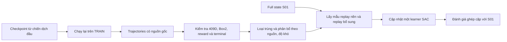
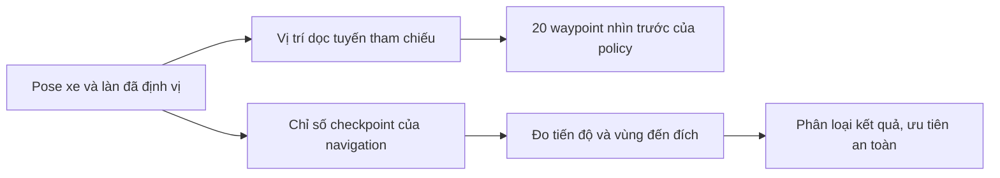
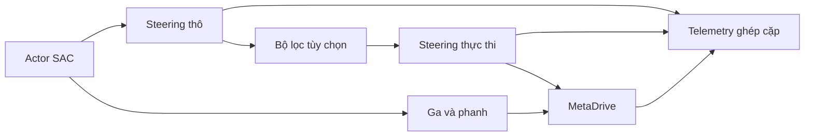

# Hoàn thiện chính sách SAC sau chiến dịch huấn luyện song song

## Kết quả mô hình tham chiếu

Chiến dịch thu được 28.089.738 quyết định môi trường và 14.044.867 lượt cập nhật SAC đã ghi nhận qua 24 lần thực thi cho 16 workload. Có 13 workload hoàn thành và ba workload kết thúc do lỗi định vị tuyến. Tổng thời gian quan sát được từ timestamp log là 173,04 giờ notebook. Đây là tổng của chiến dịch, gồm các lần phục hồi. Phiên bản S01 được chọn từ các checkpoint của learner độc lập.

| Độ khó | Hoàn thành an toàn | Lỗi an toàn | Hết thời gian | Tiến độ tuyến trung bình |
|---|---:|---:|---:|---:|
| Easy | 12/12 | 0 | 0 | 98,9% |
| Medium | 10/12 | 2 | 0 | 88,4% |
| Hard | 2/12 | 10 | 0 | 61,4% |
| Extreme | 0/12 | 10 | 2 | 19,4% |

Các số liệu lấy từ panel xác nhận nội bộ. Bảng số gốc có tốc độ và thời gian hoàn thành ở [baseline_s01.csv](baseline_s01.csv).

## Tổng hợp kinh nghiệm

SAC học off-policy, nên có thể huấn luyện từ hành động đã thực thi bởi nhiều chính sách thu thập. Mỗi transition cần giữ liên kết giữa trạng thái, hành động, reward, trạng thái kế tiếp và cách episode kết thúc. S01 cung cấp trọng số, optimizer và replay nền. Chunks bổ sung được xác minh riêng và chỉ nhận từ TRAIN. [Haarnoja và cộng sự, ICML 2018](https://proceedings.mlr.press/v80/haarnoja18b.html)

Kho replay lịch sử phục vụ resume có đủ trạng thái ring và checksum. Kiểm kê 99 manifest checkpoint từ 15 job không thấy chunk lịch sử có provenance cấp transition để hợp nhất chéo learner. Giữ ring S01 với 122.880 transition, trong đó 5.300 mẫu guided được bảo vệ. Số transition lịch sử nhập từ learner khác là **0**.

Hai chính sách S01 và S09 được chạy lại trên cùng năm cặp geometry và seed TRAIN, phủ bốn tier. Trong panel xác nhận trước đó, S09 đã hoàn thành hai ca Medium mà S01 bỏ lỡ, nên được chọn làm nguồn bổ sung. Lượt thu mới có sáu episode thành công, một episode văng đường và ba episode va chạm xe. Các episode Hard và Extreme đóng góp dữ liệu thất bại trong lượt thu này.

| Chính sách thu thập | Transition mới | Đủ điều kiện sau deduplication |
|---|---:|---:|
| S01 | 3.336 | 3.336 |
| S09 | 2.250 | 2.250 |
| Tổng | 5.586 | 5.586 |

Từ bộ dữ liệu ban đầu, pilot trên máy local đã thực hiện 128 SAC updates. Sau đó, thêm S13 vào nhóm thu thập và thu tiếp 53.724 transition. Learner đạt tổng cộng 10.000 SAC updates, với 640.000 lượt mẫu bổ sung thực sự tham gia minibatch. [Kết quả thực nghiệm tổng hợp replay](LOCAL_CONSOLIDATION.md) · [Bảng thu thập theo episode của lượt đầu](consolidation_episodes.csv)

## Waypoint và chuyển checkpoint

MetaDrive chuyển chỉ số checkpoint khi xe được định vị trên làn có nút đầu thuộc phần còn lại của tuyến và tọa độ dọc làn nhỏ hơn 5 m. Quan sát của policy có 20 waypoint nhìn trước, lấy mẫu lại từ vị trí dọc tuyến mỗi chu kỳ với khoảng cách 2,5 m. Bộ Terminal Preview V1 xử lý phần nhìn trước gần cuối tuyến. Tiêu chí đến đích dùng vùng ở làn cuối và bộ phân loại ưu tiên phát hiện lỗi an toàn.

Trong hai lần chạy S01, Medium ghi nhận 9 lần chuyển checkpoint và Hard ghi nhận 14. Tại cả 23 lần chuyển, xe cách tâm marker trước đó từ 0,38 đến 2,13 m và cách điểm đầu làn tham chiếu hơn 1 m. Hai ca hoàn thành an toàn và đạt trên 99% tiến độ. Waypoint đầu tiên thay đổi ở 687/687 cặp bước Medium và 1.246/1.253 cặp bước Hard. Kiểm tra runtime cho thấy hệ số thưởng bám giữa làn tùy chọn đang tắt trong hai ca.

Kết quả xác nhận xe có thể tiến tuyến mà không cần đi qua đúng tọa độ waypoint. Vì vậy, giữ cơ chế hiện hành. Kiểm tra hàm chuyển checkpoint cũng cho thấy phạm vi của kết luận này. Hàm dùng nút đầu làn và longitudinal range, nên bản thân nó chưa đảm bảo mọi điều kiện của một cổng cắt ngang theo quỹ đạo quét. [Số liệu chạy thử](checkpoint_gate.csv) · [MetaDrive](https://github.com/metadriverse/metadrive)

## Độ mượt điều khiển

Thí nghiệm ghép cặp dùng 24 ca mô phỏng phát triển, sáu ca mỗi tier. Mỗi tier chọn một geometry thuộc từng family và giữ hai seed môi trường. Cùng model S01 chạy ba cấu hình ở 10 Hz. Bộ lọc cố định dùng hệ số EMA 0,55. Bộ thích nghi dùng hệ số trong khoảng 0,35–0,85, giảm ở tốc độ cao trên đoạn ít cong và tăng ở đoạn có độ cong lớn. Bộ lọc làm mới trạng thái đầu mỗi episode và truyền nguyên lệnh ga/phanh do actor chọn.

So sánh độ mượt trên phần đầu có cùng số bước ở ba cấu hình của từng ca. Kết quả hoàn thành và an toàn sử dụng toàn episode. Đảo dấu steering dùng deadband 0,02, bão hòa tính từ độ lớn 0,98. Sai lệch ngang đo tới tim làn hiện tại. Yaw rate, gia tốc ngang và jerk được ước lượng sai phân ở 10 Hz. Thời gian chạy chỉ so trên những ca cả hai cấu hình đều hoàn thành an toàn. [Danh sách ca ghép cặp](steering_cases.csv)

| Cấu hình S01 | Hoàn thành an toàn | Lỗi an toàn | Mean \|Δsteering\| | RMS Δsteering | Tỷ lệ đảo dấu | RMS jerk ngang (m/s³) |
|---|---:|---:|---:|---:|---:|---:|
| Gốc | 11/24 | 13 | 0,2784 | 0,4150 | 35,08% | 45,38 |
| EMA cố định | 13/24 | 11 | 0,1708 | 0,2289 | 20,79% | 31,97 |
| EMA thích nghi | 11/24 | 13 | 0,1728 | 0,2387 | 21,80% | 32,71 |

Cả 72 lượt đều kết thúc và không có timeout. Lệnh steering gốc trùng với lệnh được simulator áp dụng trên toàn bộ phần so sánh của profile gốc. Dao động đã xuất hiện trong tín hiệu điều khiển ở chế độ chạy không hiển thị, vì vậy camera không giải thích được dao động đo được. Phép đo chưa tách tác động nhân quả giữa feedback của actor, thay đổi waypoint và lệnh ga/phanh.

Bộ lọc cố định giảm mean |Δsteering| khoảng 38,7%. Trên sáu ca Medium, clean success tăng từ 4/6 lên 6/6, nhưng một ca Hard vốn hoàn thành đã chuyển sang văng đường. Bộ thích nghi cũng giảm đảo dấu và jerk, còn tiến độ Hard trung bình giảm từ 64,46% xuống 58,62%. RMS yaw rate và RMS gia tốc ngang tăng với cả hai bộ lọc trên panel này. Độ mượt của tín hiệu steering và chuyển động thân xe vì vậy cần được đánh giá riêng. [Bảng theo tier](steering_summary.csv) · [Bảng theo từng ca](steering_episodes.csv)

## Lựa chọn bàn giao

Chọn **S01 với steering nguyên bản** cho bản bàn giao đa tier. Hai bộ lọc vẫn là cấu hình SANDBOX có nhãn riêng. Demo hiển thị với bộ lọc cố định trên một ca Medium hoàn thành an toàn trong 72,6 giây mô phỏng và đạt 99,18% tiến độ. Các kết quả trên là bằng chứng mô phỏng phát triển. [Đánh giá S01 và các checkpoint học từ replay tổng hợp](LOCAL_CONSOLIDATION.md)
