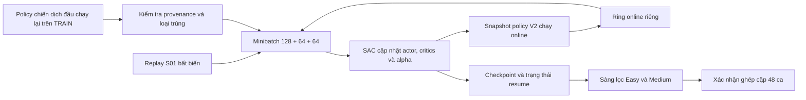

# Tổng hợp kinh nghiệm SAC V2

## Mô phỏng và kiểm tra tương đương

Bốn tiến trình MetaDrive độc lập chạy headless. Mỗi worker dùng một luồng tính toán, giữ tiến trình và policy đã nạp qua các episode. Mỗi ca vẫn dùng đúng geometry, seed và trình tự reset của simulator gốc. Physics timestep 0,02 giây, năm physics steps cho mỗi quyết định và tần số điều khiển 10 Hz được giữ nguyên. Observation 409D, hành động Box2, native reward, horizon và evaluator dùng cùng đường thực thi với S01.

Bốn ca chẩn đoán Easy và Medium của S01 khớp outcome, tiến độ, tốc độ và thời gian hoàn thành với dữ liệu đã lưu. Chỉ số tăng tốc tổng bằng decisions/s chia cho 10. Chỉ số theo worker dùng thời gian worker nhận và thực thi các ca, gồm khởi tạo policy khi cần, reset và xử lý đầu ra. RSS là giá trị cao nhất quan sát được khi worker kết thúc một ca.

## Nguồn replay

Khảo sát đủ 16 learner thông qua 519 mục trong danh mục chiến dịch đầu tiên. Các mục gồm 13 final state, 86 periodic state và 420 screening policy. Đối chiếu manifest và dấu vết lineage của 99 full state. Cursor nằm trong ring phục vụ resume và metadata không đủ để ánh xạ từng hàng còn sống sang geometry, episode và tier khi hợp nhất chéo learner. Số hàng nhập mới từ ring lịch sử là 0. Có 14 learner có model được ràng buộc với full state để dùng thu lại. Hai learner chỉ có screening policy trong danh mục này.

Lượt V2 giữ 59.310 transition đã xác minh của V1. Replay Hard và Extreme vẫn được lưu cho nghiên cứu tiếp theo. Minibatch V2 lấy dữ liệu bổ sung từ Easy và Medium. Policy nguồn chạy lại trên geometry thuộc TRAIN với seed đã xác định trước. Các episode thành công và thất bại đều đi qua cùng bước kiểm tra provenance, hành động thực thi, native reward, trạng thái kế tiếp và cờ kết thúc.

| Tier | Hàng V1 giữ lại | Hàng mới từ policy nguồn | Geometry TRAIN trong lượt thu V2 |
|---|---:|---:|---:|
| Easy | 5.262 | 85.552 | 39/39 |
| Medium | 26.220 | 122.744 | 39/39 |
| Hard | 13.162 | 0 | — |
| Extreme | 14.666 | 0 | — |
| Tổng | 59.310 | 208.296 | 78/78 Easy và Medium |

Toàn bộ 14 policy đủ điều kiện đã đóng góp. Đợt thu chứa 582 episode đủ điều kiện, với 292 cặp geometry–seed Easy và 290 cặp Medium. Trong đó có 274 lần hoàn thành Easy và 120 lần hoàn thành Medium. Hai episode khác bị loại vì lỗi định vị và không vào bộ lấy mẫu. Thông lượng cả 15 đợt thu policy nguồn đạt 457,8 quyết định hợp lệ mỗi giây, tương đương x45,8 trong 455 giây. Đợt nhanh nhất đạt 637,6 decisions/s, tương đương x63,8. Mức RSS cao nhất quan sát được trong nhóm worker thu policy nguồn là 409,8 MiB trên một worker. RAM hệ thống còn trống thấp nhất ở các điểm đo này là khoảng 3.089 MiB.

Trong 10 đợt thu liên tiếp sau khi đã đạt mốc 2.000 updates, bốn worker xử lý 136.910 quyết định trong 237 giây, trung bình 577,7 decisions/s, tương đương x57,8. Chỉ số này dùng riêng wall time của các đợt thu, gồm reset và ghi chunk. Thời gian học, đánh giá và xuất checkpoint được đo riêng.

## Hybrid SAC

Toàn trạng thái S01 cung cấp model, optimizer, alpha và replay nền bất biến. Replay mới từ policy hiện tại nằm trong ring riêng. Chính sách online là snapshot deterministic tại đầu đợt thu để giữ steering gốc và xác định chính xác policy tạo từng transition. Các đợt thu lưu trọn episode. Learner nhận số hàng online vừa đủ để giữ một update cho mỗi hai hàng online được tiếp nhận. Các hàng còn lại vẫn nằm trong chunk để truy vết. Vì vậy, UTD tính trên toàn bộ quyết định đã chạy thấp hơn UTD tính trên hàng được tiếp nhận.

Minibatch 256 có 128 lượt nền, 64 lượt từ policy nguồn và 64 lượt online. Phần policy nguồn gồm 22 lượt Easy và 42 lượt Medium, gần tỷ lệ mục tiêu 35/65. Actor LR là 0,000025 và critic LR là 0,0001. Phép đo đọc trực tiếp optimizer sau cập nhật để kiểm tra SB3 không thay các giá trị đó. SAC giữ batch size 256, gamma 0,99, tau 0,005 và cơ chế học hệ số entropy hiện có.

Tổng cộng thực thi 11.000 updates, gồm 1.000 updates của nhánh đã loại sau khi quay về một checkpoint cũ. Nhánh dài nhất có 10.000 updates. Tính trên toàn bộ lần cập nhật đã thực thi, learner lấy 1.408.000 lượt mẫu từ S01, 704.000 lượt từ policy nguồn và 704.000 lượt online. Các lượt policy nguồn gồm 242.000 Easy và 462.000 Medium. Bộ đếm cho thấy actor, critic và alpha optimizer tiếp tục từ S01 ở mọi mốc. Không thấy loss hay giá trị Q không hữu hạn.

Các snapshot online chạy 32.140 quyết định trên 68 episode. Tổng cộng có 22.000 hàng được nạp vào các nhánh đã học, gồm 4.197 Easy và 17.803 Medium. 10.140 hàng hợp lệ còn lại được giữ trong chunk. Thời gian riêng cho gradient updates là 176,5 giây. Bốn worker đạt trung bình 275,4 decisions/s khi thu online, 425,1 decisions/s khi sàng lọc và 184,5 decisions/s khi xác nhận đủ 48 ca.

## Đánh giá

Panel sàng lọc được khóa trước khi học. Panel dùng bốn ca Easy và bốn ca Medium, gồm hai ca Medium mà S01 thất bại. Chỉ các checkpoint được xếp hạng cao trên panel nhỏ được đưa sang đánh giá đủ 48 ca. Bản bàn giao chỉ thay S01 khi checkpoint mới có cải thiện đo được và giữ clean success cùng an toàn trên từng tier. Các panel thuộc chẩn đoán mô phỏng nội bộ.

Mốc V2 2.000 giữ 12/12 Easy và tăng Hard lên 5/12 nhưng chỉ đạt 5/12 Medium trên panel đầy đủ. Panel nhỏ đã cho 3/4 Medium ở chính checkpoint này. Do đó, learner quay về mốc 1.000 đã xác minh. Nhánh tiếp tục giữ nguyên learning rate và trộn replay rộng hơn sau khi thu đủ 78 geometry Easy và Medium. Mốc 5.000 trên nhánh này đạt 12/12 ở cả Easy lẫn Medium và giảm lỗi an toàn trên Hard và Extreme từ 10 xuống 7 ở mỗi tier.

Mỗi ô dưới đây ghi số ca clean và số lỗi an toàn trong 12 ca.

| Mô hình | Easy | Medium | Hard | Extreme |
|---|---:|---:|---:|---:|
| S01 | 12 / 0 | 10 / 2 | 2 / 10 | 0 / 10 |
| V1, 128 updates | 12 / 0 | 11 / 1 | 1 / 11 | 0 / 12 |
| V1, 10.000 updates | 11 / 1 | 7 / 5 | 3 / 8 | 0 / 7 |
| V2, 3.000 updates | 12 / 0 | 11 / 1 | 3 / 9 | 0 / 6 |
| **V2, 5.000 updates** | **12 / 0** | **12 / 0** | **3 / 7** | **0 / 7** |
| V2, 7.500 updates | 7 / 5 | 10 / 2 | 1 / 11 | 0 / 9 |
| V2, 10.000 updates | 12 / 0 | 11 / 1 | 4 / 8 | 0 / 11 |

Chọn **V2 tại 5.000 updates**. So với S01, xe nhanh hơn trung bình 4,13 giây trên 12 ca Easy cùng hoàn thành và 1,15 giây trên 10 ca Medium cùng hoàn thành. Hard tăng một ca clean và giảm ba lỗi an toàn, trong khi tiến độ trung bình giảm từ 61,4% xuống 58,4% và xuất hiện hai timeout. Extreme tăng tiến độ trung bình từ 19,4% lên 26,9%. Số timeout Extreme tăng từ hai lên năm và chưa có ca clean. V2 đạt mục tiêu giữ Easy và cải thiện Medium trên panel này. So sánh chưa tách riêng ảnh hưởng của tỷ lệ replay, quy mô dữ liệu và cường độ học.

Full state được nạp lại và tái tạo đúng minibatch kế tiếp từ các replay manifest đã khóa. Nhánh của model bàn giao đã dùng 10.000 hàng online, lấy 640.000 lượt mẫu nền, 320.000 lượt từ policy nguồn và 320.000 lượt online. Demo qua launcher chung ở chế độ headless hoàn thành an toàn một ca Medium trong 63,9 giây mô phỏng, đạt 99,22% tiến độ. S01 và J11 vẫn được bảo toàn để đối chứng và dự phòng.

## Dữ liệu báo cáo

- [Kết quả S01, V1 và V2 theo tier](v2_comparison.csv) gồm tiến độ, tốc độ, lỗi và chênh lệch thời gian trên các ca clean chung.
- [Transition và kết cục theo nguồn](v2_replay.csv) gồm replay V1, replay mới và online.
- [Số mẫu, loss, alpha và Q theo checkpoint](v2_learning.csv).
- [Thông lượng, hệ số thời gian thực và RAM theo worker](v2_throughput.csv).
