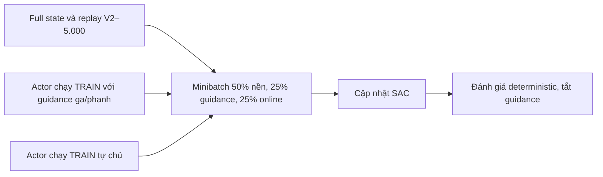

# Risk-aware SAC trên MetaDrive

## Tái hiện tình huống dừng ở Extreme

Trên đúng ca mô phỏng đã trình diễn, SAC V2–5.000 dừng ở 39,73% tuyến và hết 297,3 giây mô phỏng. Khoảng đứng yên liên tục cuối lượt dài 51,7 giây với tốc độ dưới 1 km/h. Ở mẫu cuối, tốc độ là 0,016 km/h và lệnh ga/phanh do actor phát ra là −0,221. Lệnh đã thực thi trùng với lệnh của actor.

Ego còn ở đoạn dẫn vào vòng xuyến và chưa chạm đường kích hoạt nhóm tiếp theo. Tại cuối lượt có 20 NPC chờ trigger và 17 NPC đã kích hoạt đang gần như đứng yên. NPC kích hoạt gần nhất ở phía trước khoảng 31,4 m theo trục dọc của ego, lệch ngang khoảng 1,0 m và được phát hiện trong tập vật thể lân cận của LiDAR. Xe đó nằm trên đoạn nối phía sau đoạn ego đang đứng. Các mẫu NPC lân cận tại thời điểm này không có cờ va chạm xe. Điều này xác nhận có cụm xe đã kích hoạt đi rất chậm hoặc dừng. Bằng chứng chưa xác định được vòng chờ, nguyên nhân IDM hoặc quỹ đạo đi qua cụm xe.

Một NPC chưa kích hoạt xuất hiện trong tập vật thể lân cận của LiDAR ở đầu lượt khi TrafficContext chưa có actor nào. Ở mẫu dừng cuối lượt, LiDAR ghi nhận năm NPC đã kích hoạt trong vùng đo, còn TrafficContext có bốn slot hợp lệ. Nguồn TrafficContext lấy từ danh sách xe đã kích hoạt. Các số đo LiDAR lân cận mô tả tập phát hiện của cảm biến, còn khoảng trống trên quỹ đạo cần kiểm tra riêng. Môi trường, trigger và mật độ giao thông được giữ nguyên.

Một phép thử controller riêng bật guidance sau khi tái hiện đúng điểm dừng ở giây 136. Trong cửa sổ 40 giây tiếp theo, guidance đưa ra 12 lệnh bò chậm. Tiến độ ở cuối cửa sổ là 39,85%, so với 39,72% ở lượt đối chứng cùng thời điểm. Ego lại gần như đứng yên, nhóm 20 NPC vẫn chưa được kích hoạt. Hiệu ứng chỉ là thêm một đoạn di chuyển ngắn, chưa giải quyết được tình huống dừng. Phép thử dùng để chẩn đoán và nằm ngoài kết quả học cũng như panel xác nhận.

## Guidance và huấn luyện

Guidance chỉ đọc observation 409D sẵn có. Nó chiếu vị trí xe và vận tốc tương đối lên một hành lang cục bộ từ waypoint nhìn trước, dịch theo vị trí ngang hiện tại của ego. Phanh và theo xe dựa trên khoảng hở ước lượng giữa hai thân xe, tốc độ thu hẹp, TTC khi đang khép khoảng, và khoảng dừng. Dự báo cắt ngang yêu cầu xe đang di chuyển và có khả năng giao cắt đúng thời điểm. Độ cong được dùng để giảm tốc khi vào khúc cua. LiDAR trước xe hỗ trợ nhận ra vật thể không có trong slot traffic và chặn lệnh bò chậm khi khoảng trống không đủ.

TTC được tính bằng khoảng hở chia cho tốc độ thu hẹp và chỉ có giá trị khi tốc độ thu hẹp vượt 0,2 m/s. Tham chiếu theo xe dùng khoảng hở tối thiểu 3,5 m và headway 1,4 giây, kết hợp biên dừng phụ thuộc vào bình phương tốc độ. Tham chiếu tốc độ cua dùng căn bậc hai của tỷ số giữa gia tốc ngang tham chiếu 2,5 m/s² và độ cong ước lượng. Tốc độ cua là tham chiếu cục bộ. Khi không dựng được hành lang đáng tin cậy, controller giữ action của actor.

Guidance chỉ sửa ga/phanh trong thu thập và lưu riêng lệnh actor, lệnh hướng dẫn, lệnh thực thi và lý do. Đầu ra steering giữ nguyên. Thử nghiệm dùng cùng physics 0,02 giây, năm bước vật lý cho mỗi quyết định và native reward. Khả năng vượt xe tự động chưa được thử vì observation chưa xác nhận được làn có thể sử dụng và khoảng trống trước/sau một cách đầy đủ.

Replay nền được tái tạo đúng từ full state V2–5.000 và các sidecar. Mỗi minibatch 256 lấy 64 hàng từ ring S01, 11 Easy và 21 Medium từ replay bổ sung V2, 32 online V2, 64 trajectory mới có guidance và 64 online mới của actor. Hai nhóm mới có ring riêng. Dữ liệu Hard/Extreme đã xác minh ở V1 vẫn được lưu. Tỷ lệ này tái hiện cách lấy mẫu của V2 trong nửa minibatch nền.

## Kiểm tra retention

Lượt đầu thêm 16.035 transition guidance đủ điều kiện và lấy 256 hàng online mới từ các episode hoàn chỉnh. Tiến hành 128 SAC updates, với 16.384 lượt mẫu nền, 8.192 lượt guidance và 8.192 lượt online. Actor LR thực tế là 0,000025, critic LR là 0,0001. Cả ba optimizer tiếp tục đúng 128 bước. UTD 0,5 tính trên hàng online được tiếp nhận. Các hàng không được chọn vẫn nằm trong trajectory đã lưu.

Mốc 128 chỉ đạt 1/4 Easy ở sàng lọc nên dừng nhánh 50/25/25. Đánh giá xác nhận tắt guidance cho kết quả 5/12 Easy, 3/12 Medium, 0/12 Hard và 0/12 Extreme. Kết quả này cho thấy recipe đầu gây mất năng lực nền sớm. Thử nghiệm tiếp theo quay về V2–5.000 và nâng replay nền lên 75%, với 12,5% guidance và 12,5% online. Guidance, learning rate và các episode đầu được giữ cùng cấu hình.

Trên cùng observation TRAIN, sai khác tuyệt đối steering giữa actor gốc và actor sau 128 updates của nhánh đầu có median 0,211 ở Easy, 0,490 ở Medium và 0,619 ở Hard. Ở Medium, 25,2% observation có dấu steering khác nhau và cả hai action đều vượt deadband 0,05. Đây là sai khác của hai actor trên cùng đầu vào. Phép đo này độc lập với độ dài episode và bổ sung bằng chứng về policy drift, nhưng chưa xác định gradient hoặc nguồn dữ liệu nào gây ra drift.

## Chỉ số hành vi

Panel hành vi dùng tám ca ghép cặp, hai ca mỗi tier. Các chỉ số dùng toàn episode nên chịu ảnh hưởng của khác biệt về thời gian và kiểu kết thúc. Lệnh phanh được đánh dấu khi ga/phanh dưới −0,15. Proxy phanh khi đường thoáng yêu cầu tốc độ trên 2 m/s, LiDAR trước trên 13 m, độ cong dưới 0,025 m⁻¹, không có nguy cơ theo heuristic và không có khoảng hở theo xe dưới 18 m. Khoảng hở, TTC và closing speed chỉ được đo khi có actor liên quan. Chuỗi đứng yên dùng ngưỡng 1 km/h.

Giữ làn ổn định được đo khi tâm xe nằm trong một phần tư bề rộng quanh tim của cùng làn ít nhất một giây. Chỉ báo đè vạch dựa trên thân xe và biên hình học của một làn cùng chiều, nên được báo cáo là proxy. Số đổi chỉ số làn tính trong cùng road. Telemetry hiện chưa xác định được động cơ chuyển làn. Đổi dấu steering dùng deadband 0,05. Gia tốc ngang và jerk được ước lượng từ sai phân vận tốc 10 Hz trong khung hướng ego. Vào và thoát cua dùng ngưỡng độ cong cục bộ 0,035 m⁻¹.

So với V2–5.000 trên tám ca này, nhánh 50/25/25 tăng proxy phanh khi thoáng từ 1,5% lên 18,2% số bước phanh. Tỷ lệ giữ làn ổn định giảm từ 44,0% còn 39,9%, và đổi chỉ số làn trên cùng road tăng từ 68 lên 150. Mean absolute steering change gần như giữ nguyên, từ 0,152 xuống 0,151. Thời gian đứng yên khi có dấu hiệu thoáng giảm từ 412,3 xuống 289,3 giây, nhưng số quyết định cũng giảm từ 10.884 xuống 8.589 và an toàn suy giảm trên panel đầy đủ. Chỉ số đứng yên riêng lẻ chưa đủ để chứng minh điều khiển tốt hơn.

## Kết quả trên panel xác nhận

Mỗi ô ghi clean / lỗi an toàn / timeout trên 12 ca. Cả hai nhánh mới đánh giá deterministic, tắt guidance.

| Model | Easy | Medium | Hard | Extreme |
|---|---:|---:|---:|---:|
| V2–5.000 | 12 / 0 / 0 | 12 / 0 / 0 | 3 / 7 / 2 | 0 / 7 / 5 |
| Risk 50/25/25, 128 updates | 5 / 7 / 0 | 3 / 9 / 0 | 0 / 10 / 2 | 0 / 8 / 4 |
| Retention 75/12,5/12,5, 128 updates | 12 / 0 / 0 | 3 / 9 / 0 | 3 / 8 / 1 | 0 / 11 / 1 |

Nhánh retention bảo toàn Easy và khôi phục số ca clean Hard so với nhánh đầu, nhưng Medium và an toàn vẫn kém V2. Nhánh retention cũng dừng ở mốc 128. Cả hai lượt dùng cùng 16.035 transition guidance và 6.755 transition online mới từ 20 episode TRAIN, không tính lại hai lần. Mỗi nhánh nhận cùng 256 hàng online. Trong 16.035 hàng guidance, Medium có 2.484 hàng, Hard 4.639 và Extreme 8.912. Guidance can thiệp chủ yếu vì khép khoảng cách, độ cong và bò chậm khi thoáng. Có 256 updates thực thi trên hai nhánh độc lập. Gộp lượt lấy mẫu trên hai nhánh cho 40.960 lượt nền, 12.288 lượt guidance và 12.288 lượt online.

Bốn worker đạt 48,7 quyết định/s ở wave guidance và 34,3 quyết định/s ở wave online đầu, gồm reset và ghi artifact. Các số đo này phản ánh hỗn hợp có nhiều ca Hard/Extreme hơn V2. Cả hai nhánh được lưu độc lập. **Giữ V2–5.000 làm model bàn giao.**

Nhánh retention có tỷ lệ giữ làn ổn định 46,7% trên tám ca ghép cặp, cao hơn 44,0% của V2. Cùng lúc đó, biến thiên steering trung bình tăng từ 0,152 lên 0,211 và jerk ngang tuyệt đối trung bình tăng từ 16,0 lên 27,1 m/s³. Proxy phanh khi thoáng tăng lên 23,8%. Thời gian ít di chuyển giảm, nhưng nhánh retention chỉ chạy 4.802 quyết định so với 10.884 ở V2 trên cùng nhóm ca. Không dùng số đếm này để kết luận xe đã bớt mắc kẹt một cách an toàn.

Full state của hai pilot giữ optimizer, RNG và các replay sidecar. Đối chiếu minibatch kế tiếp phát hiện serializer sắp xếp lại khóa tỷ lệ replay. Bộ lấy mẫu đã được sửa để lấy các nhóm theo thứ tự cố định. Phép nạp lại từ checkpoint hiện có sau khi sửa tái tạo đúng hash minibatch mà không chạy thêm cập nhật.

Nhánh retention được demo qua launcher chung với steering gốc và guidance tắt. Xe hoàn thành sạch một ca Hard trong 134,1 giây mô phỏng, đạt 99,39% tuyến. Đây là kết quả của ca demo. Quyết định giữ V2–5.000 dựa trên toàn bộ panel 48 ca.

[So sánh 48 ca](risk_comparison.csv) · [Sàng lọc](risk_screening.csv) · [Replay theo tier và lý do can thiệp](risk_replay.csv) · [Optimizer và số lượt lấy mẫu](risk_learning.csv) · [Chỉ số hành vi](risk_behavior.csv)
